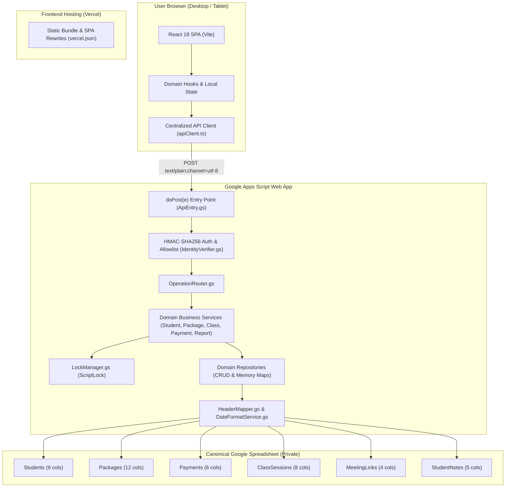
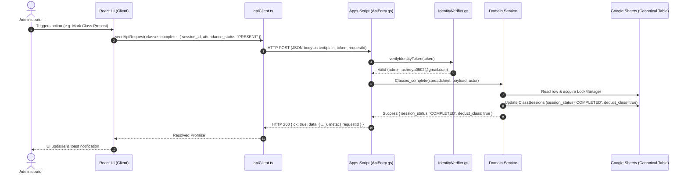
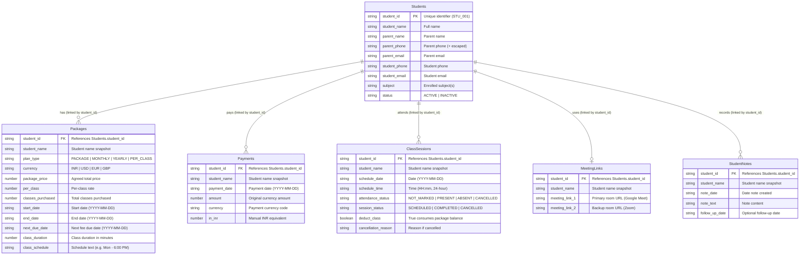
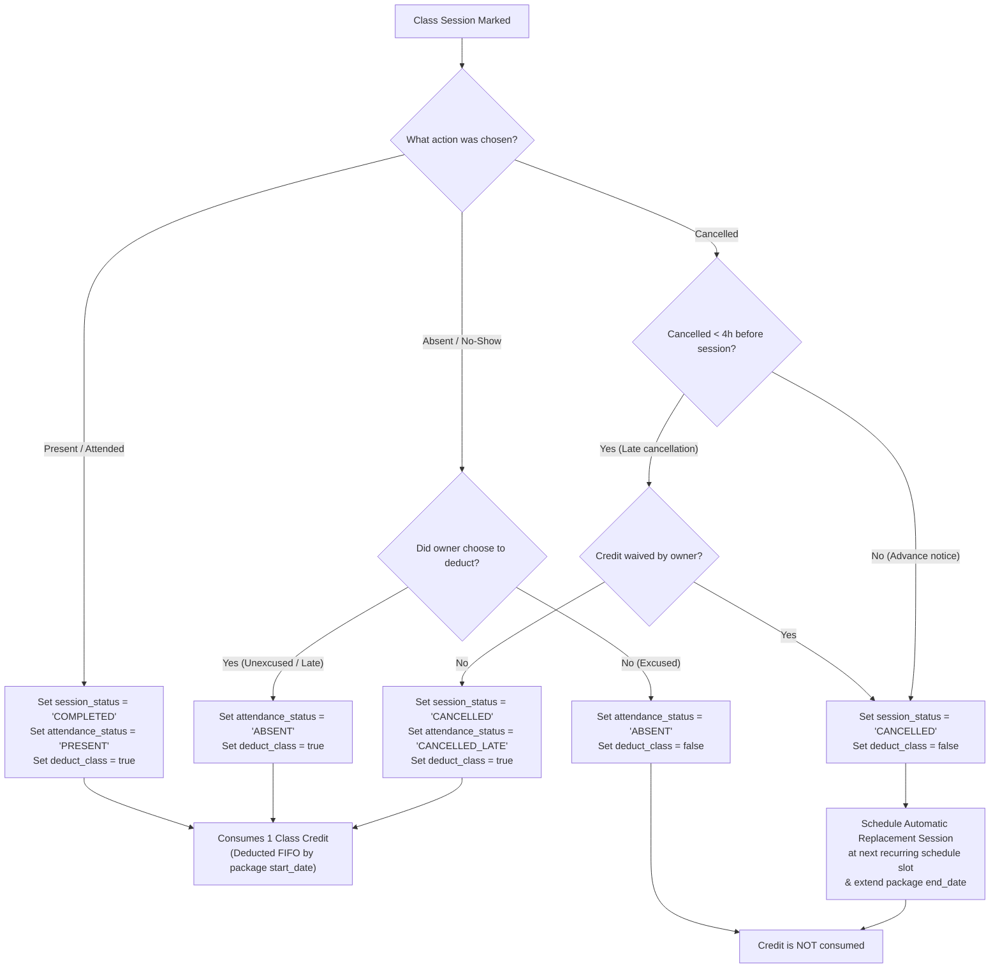
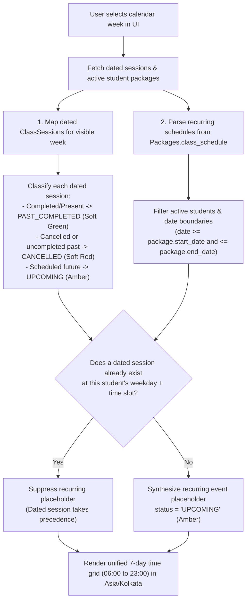

# 02 — System Architecture

## 1. Document Control

- **Product:** Personal Dashboard (Student Management Dashboard)
- **Document ID:** 02
- **Status:** Authoritative Architecture Specification
- **Version:** 4.0.0
- **Audience:** Developers, architects, AI coding agents

## 2. Architectural Principles & Stack

1. **Frontend-Backend Separation:**
   - **Frontend:** React 18, TypeScript, and Vite. Static single-page application hosted on Vercel.
   - **Backend:** Google Apps Script (GAS) Web App deployed as an executable API endpoint.
   - **Datastore:** Exactly six Google Sheets tables in a single private Google Spreadsheet.
2. **Strict Datastore Boundary:**
   - The browser never communicates directly with the Google Sheets API.
   - All spreadsheet reads and mutations pass through the authenticated Apps Script Web App.
3. **Zero-GCP Authentication:**
   - No Google Cloud Console, GCP project, OAuth consent screen, or OAuth credentials are required.
   - Session authentication uses server-side HMAC-SHA256 tokens signed with `ADMIN_AUTH_KEY` stored in Apps Script `ScriptProperties`.
4. **Transport via CORS-Free Text/Plain POST:**
   - The frontend issues HTTP POST requests with `Content-Type: text/plain;charset=utf-8` and `redirect: 'follow'`.
   - Using `text/plain` prevents CORS preflight (`OPTIONS`) requests, which Google Apps Script Web Apps cannot answer.
5. **Micro-File Architecture:**
   - Every source file in `src/` and `public/` is strictly $\le 149$ lines, organized by single-responsibility domains.

## 3. High-Level Architecture Diagram

## 4. Request & Response Lifecycle Flow

## 5. Domain Relationship Diagram

The canonical datastore contains **strictly six tables** with all secondary records linking directly to `Students.student_id`.

## 6. Attendance & Class Deduction Workflow

## 7. Calendar Hybrid Event Synthesis

