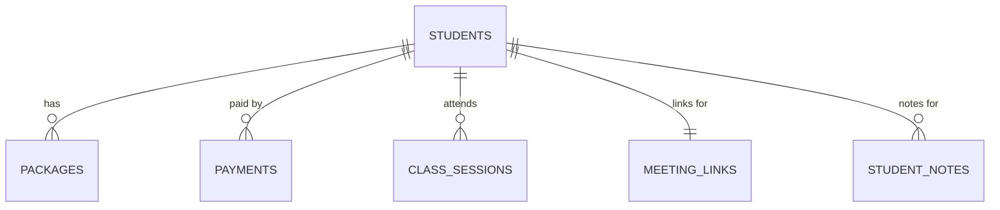

# 02 — Entity Relationships and Data Dictionary

**Project:** Student Management Dashboard / Personal Dashboard  
**Status:** Authoritative Architecture Specification  
**Version:** 3.0.0 (Finalized Owner 6-Table Schema)  
**Companion Schema:** `03-data/01-master-spreadsheet-schema.md`  
**Canonical Reference:** `00-documentation/04-google-sheets-data-model.md`

---

## 1. Purpose & Relationship Model

This document defines the entities stored by the Personal Dashboard, their authoritative data dictionary, relationships, field meanings, allowed values, validation expectations, and relational integrity rules.

### 1.1 Direct Student-Centric Cardinality
All operational business entities relate directly to `Students` without requiring intermediate tables (`Enrollments`, `FeeObligations`):

1. **Student to Packages (1:N)**: A student has one or more course packages, monthly plans, or per-class billing arrangements.
2. **Student to Payments (1:N)**: Payment transactions belong directly to a student (`amount` in original currency and manually entered `in_inr`).
3. **Student to ClassSessions (1:N)**: Scheduled and completed classes link directly to a student, with attendance and the `deduct_class` boolean flag.
4. **Student to MeetingLinks (1:1)**: Flat structure with 1 row per student storing primary `meeting_link_1` and optional secondary `meeting_link_2`.
5. **Student to StudentNotes (1:N)**: Dated remarks, progress notes, and optional follow-up dates belong directly to a student.

---

## 2. Authoritative Data Dictionary

### 2.1 Entity: `Students` (Canonical Tab: `Students` — 9 columns)
One permanent record per student.

| Field Name | Type | Mandatory | Nullable | Description & Domain Rules |
|---|---|---|---|---|
| `student_id` | String ID | Yes | No | Stable backend-generated identifier (`stu_...`). Primary key. |
| `student_name` | String | Yes | No | Unified student display name. No separate first/last names. |
| `parent_name` | String | Yes | No | Primary parent or guardian contact name. |
| `parent_phone` | String | Yes | No | Parent WhatsApp/calling phone number with country code. |
| `student_phone` | String | No | Yes | Optional direct student phone number. |
| `parent_email` | String | No | Yes | Parent email address for invoices and fee receipts. Validated format. |
| `student_email` | String | No | Yes | Direct student email for calendar invites. Strictly independent of `parent_email`. |
| `subject` | String | No | Yes | Dedicated enrolled subject/grade (e.g. "Grade 10 Mathematics"). |
| `status` | Enum | Yes | No | `ACTIVE`, `INACTIVE`. Distinguishes active vs inactive students. |

---

### 2.2 Entity: `Packages` (Canonical Tab: `Packages` — 11 columns)
Prepaid blocks, monthly/yearly subscription plans, or per-class billing terms.

| Field Name | Type | Mandatory | Nullable | Description & Domain Rules |
|---|---|---|---|---|
| `package_id` | String ID | Yes | No | Unique immutable identifier (`pkg_...`). Primary key. |
| `student_id` | String ID | Yes | No | Foreign key linking package to `Students.student_id`. |
| `student_name` | String | Yes | No | Snapshot of student name for spreadsheet readability. |
| `plan_type` | Enum/Text | Yes | No | `PACKAGE`, `MONTHLY`, `YEARLY`, `PER_CLASS`. |
| `currency` | Text | Yes | No | Billing currency (`INR`). |
| `package_price` | Numeric | Yes | No | Total agreed price for package or recurring billing amount. Non-negative. |
| `per_class` | Numeric | No | Yes | Effective rate per individual session. Non-negative. |
| `classes_purchased`| Integer | Yes | No | Total class sessions purchased (positive integer; 0 for unlimited time plans). |
| `start_date` | Date | Yes | No | Plan commencement date (`YYYY-MM-DD`). |
| `end_date` | Date | No | Yes | Expiration or validity end date (`YYYY-MM-DD`). Must be $\ge$ `start_date`. |
| `next_due_date` | Date | No | Yes | Next billing payment due date (`YYYY-MM-DD`). |

*Balance Derivation:*
- Consumed class credits = sum of sessions in `ClassSessions` for this `student_id` where `deduct_class == true`. Deducted FIFO across packages by `start_date`.
- Remaining class credits = $\max(0, \text{classes\_purchased} - \text{consumed\_classes})$.

---

### 2.3 Entity: `Payments` (Payment Details — Canonical Tab: `Payments` — 6 columns)
Direct ledger of payments received.

| Field Name | Type | Mandatory | Nullable | Description & Domain Rules |
|---|---|---|---|---|
| `student_id` | String ID | Yes | No | Foreign key to `Students.student_id`. |
| `student_name` | String | Yes | No | Snapshot of student name. |
| `payment_date` | Date | Yes | No | Date funds were received (`YYYY-MM-DD`). |
| `amount` | Numeric | Yes | No | Exact cash/bank amount received in original currency. Positive numeric ($> 0$). |
| `currency` | Text | Yes | No | Currency code of payment receipt (`INR`, `USD`, `GBP`). |
| `in_inr` | Numeric | No | Yes | Amount in INR. Entered manually; never overwritten by automatic conversion. |

---

### 2.4 Entity: `ClassSessions` (Canonical Tab: `ClassSessions` — 8 columns)
Class scheduling, attendance records, and session credit deduction.

| Field Name | Type | Mandatory | Nullable | Description & Domain Rules |
|---|---|---|---|---|
| `class_session_id` | String ID | Yes | No | Unique session identifier (`cls_...`). Primary key. |
| `student_id` | String ID | Yes | No | Foreign key to `Students.student_id`. |
| `scheduled_start` | Timestamp | Yes | No | Scheduled start timestamp (ISO 8601). |
| `scheduled_end` | Timestamp | Yes | No | Scheduled end timestamp (ISO 8601). Must be $>$ `scheduled_start`. |
| `attendance_status`| Enum | Yes | No | `NOT_MARKED`, `ATTENDED`, `PRESENT`, `ABSENT`, `CANCELLED`. |
| `session_status` | Enum | Yes | No | `SCHEDULED`, `COMPLETED`, `CANCELLED`. |
| `cancellation_reason`| String | No | Yes | Reason for cancellation if session was cancelled. |
| `deduct_class` | Boolean | Yes | No | Boolean (`TRUE`/`FALSE`) indicating whether this session deducts 1 class credit. |

*Deduction Rules:*
- `ATTENDED` / `PRESENT` $\rightarrow$ automatically `deduct_class = true`.
- `ABSENT` $\rightarrow$ caller/owner specifies whether to deduct.
- `NOT_MARKED` $\rightarrow$ `deduct_class = false`.
- `CANCELLED` $\rightarrow$ does not automatically deduct (`deduct_class = false` unless explicitly set by owner).

---

### 2.5 Entity: `MeetingLinks` (Canonical Tab: `MeetingLinks` — 4 columns)
Flat virtual meeting room configuration per student.

| Field Name | Type | Mandatory | Nullable | Description & Domain Rules |
|---|---|---|---|---|
| `student_id` | String ID | Yes | No | Foreign key to `Students.student_id`. Primary key (1 row per student). |
| `student_name` | String | Yes | No | Snapshot of student name. |
| `meeting_link_1` | URL/Text | Yes | No | Primary virtual meeting room URL (e.g. Google Meet). |
| `meeting_link_2` | URL/Text | No | Yes | Optional secondary / backup virtual meeting room URL (e.g. Zoom). |

---

### 2.6 Entity: `StudentNotes` (Canonical Tab: `StudentNotes` — 5 columns)
Pedagogical remarks and student progress tracking.

| Field Name | Type | Mandatory | Nullable | Description & Domain Rules |
|---|---|---|---|---|
| `student_id` | String ID | Yes | No | Foreign key to `Students.student_id`. |
| `student_name` | String | Yes | No | Snapshot of student name. |
| `note_date` | Date | Yes | No | Date note was recorded (`YYYY-MM-DD`). |
| `note_text` | String | Yes | No | Notes, observations, homework assigned, or student feedback. |
| `follow_up_date`| Date | No | Yes | Optional follow-up date (`YYYY-MM-DD`). |
