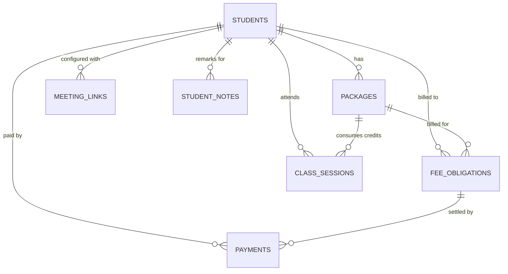

# 02 — Entity Relationships and Data Dictionary

**Project:** Student Management Dashboard / Personal Dashboard  
**Status:** Authoritative Architecture Specification  
**Version:** 2.0.0 (Finalized Owner Data Model)  
**Companion Schema:** `03-data/01-master-spreadsheet-schema.md`  
**Canonical Reference:** `00-documentation/04-google-sheets-data-model.md`

---

## 1. Purpose & Relationship Model

This document defines the entities stored by the Personal Dashboard, their authoritative data dictionary, relationships, field meanings, allowed values, validation expectations, and relational integrity rules.

### 1.1 Direct Student-Centric Cardinality
All operational entities relate directly to `Students` without requiring an intermediate `Enrollments` table:

1. **Student to Packages (1:N)**: A student can have one or more active or historical course packages, monthly plans, or per-class billing arrangements.
2. **Student to FeeObligations (1:N)**: Invoices and fee demands belong directly to a student.
3. **Student to Payments (1:N)**: All payment receipts belong directly to a student and reference a specific `fee_obligation_id`.
4. **Student to ClassSessions (1:N)**: Scheduled and completed classes link directly to a student. If a prepaid package is active, the session also references `package_id` to consume credit.
5. **Student to MeetingLinks (1:N)**: A student can have multiple video conference links (primary Google Meet, backup Zoom).
6. **Package to ClassSessions (1:N)**: When a class session consumes or restores prepaid credit, it references `package_id`.
7. **FeeObligation to Payments (1:N)**: A fee obligation can be settled by one or more partial or full payments.

---

## 2. Authoritative Data Dictionary

### 2.1 Entity: `Students` (Canonical Tab: `Students`)
One permanent record per student.

| Field Name | Type | Mandatory | Nullable | Description & Domain Rules |
|---|---|---|---|---|
| `student_id` | String ID | Yes | No | Stable backend-generated identifier (`stu_...`). Primary key. |
| `student_name` | String | Yes | No | Unified student display name (1–100 chars). No separate first/last names. |
| `parent_name` | String | Yes | No | Primary parent or guardian contact name (1–100 chars). |
| `parent_phone` | String | Yes | No | Parent WhatsApp/calling phone number with country code. |
| `student_phone` | String | No | Yes | Optional direct student phone number. |
| `parent_email` | String | No | Yes | Parent email address for invoices and fee receipts. Validated format. |
| `student_email` | String | No | Yes | Direct student email for calendar invites. Strictly independent of `parent_email`. |
| `subject` | String | No | Yes | Dedicated enrolled subject/grade (e.g. "Grade 10 Mathematics"). |
| `status` | Enum | Yes | No | `ACTIVE`, `INACTIVE`, `ARCHIVED`. Distinguishes active vs inactive students. |

---

### 2.2 Entity: `Packages` (Canonical Tab: `Packages`)
Prepaid blocks, monthly/yearly subscription plans, or per-class billing terms.

| Field Name | Type | Mandatory | Nullable | Description & Domain Rules |
|---|---|---|---|---|
| `package_id` | String ID | Yes | No | Unique immutable identifier (`pkg_...`). Primary key. |
| `student_id` | String ID | Yes | No | Foreign key linking package to `Students.student_id`. |
| `student_name` | String | Yes | No | Snapshot of student name for spreadsheet readability. |
| `plan_type` | Enum/Text | Yes | No | `PACKAGE`, `MONTHLY`, `YEARLY`, `PER_CLASS`. |
| `currency` | Text | Yes | No | Billing currency (`INR`). |
| `package_price` | Numeric | Yes | No | Total agreed price for package or recurring billing amount. Non-negative. |
| `per_class` | Numeric | No | Yes | Effective rate per individual session. Non-negative. |
| `classes_purchased`| Integer | Yes | No | Total class sessions purchased (positive integer; 0 for unlimited time plans). |
| `start_date` | Date | Yes | No | Plan commencement date (`YYYY-MM-DD`). |
| `end_date` | Date | No | Yes | Expiration or validity end date (`YYYY-MM-DD`). Must be $\ge$ `start_date`. |
| `next_due_date` | Date | No | Yes | Next billing invoice milestone date (`YYYY-MM-DD`). |

*Derived Values (Not physical columns):*
- `consumed_classes`: Sum of valid `CONSUME` records minus `CREDIT_BACK` records in `ClassSessions` for this `package_id`.
- `remaining_classes`: $\max(0, \text{classes\_purchased} - \text{consumed\_classes})$.

---

### 2.3 Entity: `FeeObligations` (Canonical Tab: `FeeObligations`)
Invoice demands, monthly tuition fees, and periodic billing obligations.

| Field Name | Type | Mandatory | Nullable | Description & Domain Rules |
|---|---|---|---|---|
| `fee_obligation_id`| String ID | Yes | No | Unique invoice identifier (`fee_...`). Primary key. |
| `student_id` | String ID | Yes | No | Foreign key to `Students.student_id`. |
| `student_name` | String | Yes | No | Snapshot of student name. |
| `package_id` | String ID | No | Yes | Optional foreign key to `Packages.package_id`. |
| `obligation_description` | String | Yes | No | Description / billing period (e.g. "October 2026 Tuition (4 classes @ ₹1,500)"). |
| `amount_due` | Numeric | Yes | No | Total billed demand amount before credit deductions. Non-negative. |
| `credit_applied` | Numeric | Yes | No | Overpayment or advance credit absorbed by this invoice. Default `0.00`. |
| `currency` | Text | Yes | No | Billing currency (`INR`). |
| `issue_date` | Date | Yes | No | Invoice issuance date (`YYYY-MM-DD`). |
| `due_date` | Date | Yes | No | Payment deadline (`YYYY-MM-DD`). |
| `obligation_status`| Enum | Yes | No | `OPEN`, `PARTIALLY_PAID`, `PAID`, `VOID`. |
| `notes` | String | No | Yes | Invoicing notes, batch generation ID, or billing terms. |
| `created_at` | Timestamp | Yes | No | ISO 8601 creation timestamp. |
| `updated_at` | Timestamp | Yes | No | ISO 8601 modification timestamp. |
| `voided_at` | Timestamp | No | Yes | ISO 8601 timestamp if invoice voided. |
| `void_reason` | String | No | Yes | Mandatory audit reason if invoice voided. |

*Derived Values:*
- `net_payable`: $\max(0, \text{amount\_due} - \text{credit\_applied})$.
- `paid_amount`: Sum of non-void `Payments.amount` referencing this `fee_obligation_id`.
- `outstanding_amount`: $\max(0, \text{net\_payable} - \text{paid\_amount})$.

---

### 2.4 Entity: `Payments` (Canonical Tab: `Payments`)
Immutable cash, UPI, or bank transaction ledger.

| Field Name | Type | Mandatory | Nullable | Description & Domain Rules |
|---|---|---|---|---|
| `payment_id` | String ID | Yes | No | Unique receipt identifier (`pay_...`). Primary key. |
| `student_id` | String ID | Yes | No | Foreign key to `Students.student_id`. |
| `student_name` | String | Yes | No | Snapshot of student name. |
| `fee_obligation_id`| String ID | Yes | No | Foreign key to `FeeObligations.fee_obligation_id`. |
| `payment_date` | Date | Yes | No | Date funds were received (`YYYY-MM-DD`). |
| `amount` | Numeric | Yes | No | Exact cash/bank amount received. Positive numeric ($> 0$). |
| `currency` | Text | Yes | No | Currency of receipt (`INR`). |
| `payment_method` | Enum | Yes | No | `UPI`, `BANK_TRANSFER`, `CASH`, `CARD`, `CHEQUE`, `OTHER`. |
| `transaction_reference` | String | No | Yes | Bank UTR, UPI reference, or check number. |
| `idempotency_key` | String | Yes | No | Unique client UUID preventing duplicate payment recording. |
| `payment_status` | Enum | Yes | No | `RECORDED`, `VOID`. |
| `notes` | String | No | Yes | Transaction remarks or overpayment note. |
| `created_at` | Timestamp | Yes | No | ISO 8601 creation timestamp. |
| `updated_at` | Timestamp | Yes | No | ISO 8601 modification timestamp. |
| `voided_at` | Timestamp | No | Yes | ISO 8601 timestamp if payment voided. |
| `void_reason` | String | No | Yes | Mandatory audit reason if payment voided. |

---

### 2.5 Entity: `ClassSessions` (Canonical Tab: `ClassSessions`)
Calendar lessons, actual attendance records, credit deductions, and restorations.

| Field Name | Type | Mandatory | Nullable | Description & Domain Rules |
|---|---|---|---|---|
| `class_session_id` | String ID | Yes | No | Unique session identifier (`cls_...`). Primary key. |
| `student_id` | String ID | Yes | No | Foreign key to `Students.student_id`. |
| `student_name` | String | Yes | No | Snapshot of student name. |
| `package_id` | String ID | No | Yes | Associated package consuming credits. |
| `meeting_link_id` | String ID | No | Yes | Virtual meeting room link used for class. |
| `class_title` | String | Yes | No | Title of session (e.g. "Rotational Mechanics"). |
| `scheduled_start` | Timestamp | Yes | No | Scheduled start timestamp. |
| `scheduled_end` | Timestamp | Yes | No | Scheduled end timestamp. Must be $>$ `scheduled_start`. |
| `actual_start` | Timestamp | No | Yes | Actual start timestamp if recorded. |
| `actual_end` | Timestamp | No | Yes | Actual end timestamp if recorded. |
| `session_status` | Enum | Yes | No | `SCHEDULED`, `COMPLETED`, `CANCELLED`, `RESCHEDULED`, `NO_SHOW`. |
| `attendance_status`| Enum | Yes | No | `NOT_MARKED`, `ATTENDED`, `ABSENT`, `EXCUSED`. |
| `class_credit_effect`| Enum | Yes | No | `PENDING`, `CONSUME`, `NO_CONSUME`, `CREDIT_BACK`. |
| `cancellation_reason`| String | No | Yes | Reason for cancellation or notice window. |
| `credit_restoration_for_session_id` | String ID | Conditional | Yes | Foreign key to original `class_session_id` for `CREDIT_BACK` records. |
| `notes` | String | No | Yes | Lesson notes, homework assigned, or remarks. |
| `created_at` | Timestamp | Yes | No | ISO 8601 creation timestamp. |
| `updated_at` | Timestamp | Yes | No | ISO 8601 modification timestamp. |
| `completed_at` | Timestamp | No | Yes | Timestamp when attendance was marked. |

---

### 2.6 Entity: `MeetingLinks` (Canonical Tab: `MeetingLinks`)
Configured video conference room links per student.

| Field Name | Type | Mandatory | Nullable | Description & Domain Rules |
|---|---|---|---|---|
| `meeting_link_id` | String ID | Yes | No | Unique link identifier (`ml_...`). Primary key. |
| `student_id` | String ID | Yes | No | Foreign key to `Students.student_id`. |
| `student_name` | String | Yes | No | Snapshot of student name. |
| `link_label` | String | Yes | No | Display label (e.g., "Primary Google Meet", "Backup Zoom"). |
| `meeting_url` | URL/Text | Yes | No | HTTPS meeting room URL. |
| `provider` | Enum | Yes | No | `GOOGLE_MEET`, `ZOOM`, `OTHER`. |
| `is_preferred` | Boolean | Yes | No | `TRUE` if primary default link for student. At most one per student. |
| `link_status` | Enum | Yes | No | `ACTIVE`, `INACTIVE`. |
| `created_at` | Timestamp | Yes | No | ISO 8601 creation timestamp. |
| `updated_at` | Timestamp | Yes | No | ISO 8601 modification timestamp. |
