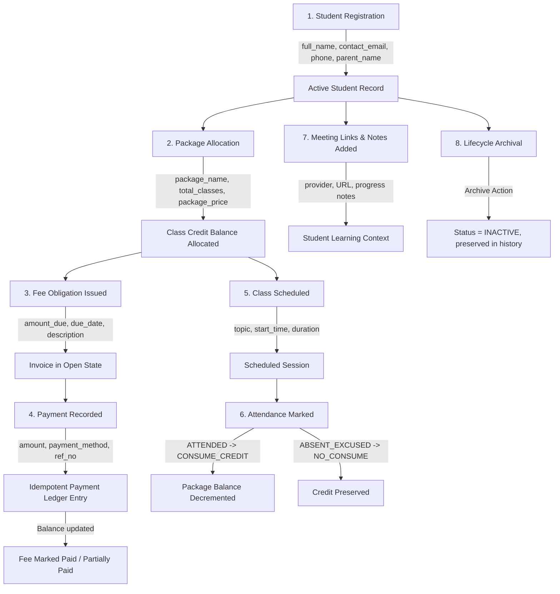

# Pre-Launch Field and Workflow Inventory

**Document Version:** 1.0.0  
**Status:** Complete Read-Only Baseline  
**Date:** October 21, 2026  
**Canonical Scope:** Personal Dashboard (Zero-GCP, Google Sheets + Apps Script + React/Vite)

---

## 1. Executive Summary

This inventory documents every user-facing screen, modal, form input, internal field, and database column across the Personal Dashboard. It traces the lifecycle of student data from initial registration through enrollment, fee billing, payment ledger recording, class scheduling, attendance tracking, note recording, meeting links, and archival.

Each field is cataloged with its source of truth, data validation rules, storage tab, display points, duplication status, and a pre-launch recommendation (Keep, Rename, Combine, Remove, or Make Configurable).

---

## 2. Field Inventory Master Table

| Screen / Form | Field Label | Internal Field Name | Required / Optional | Data Type & Validation | Storage Location | Where Displayed / Used | Duplication Status | Pre-Launch Recommendation | Reason & Affected Workflows |
|---|---|---|---|---|---|---|---|---|---|
| **Auth / Modal** | Administrator Access Key | `key` / `accessKey` | Required | String (min 1 char), password masked | Google Apps Script Script Properties (`ADMIN_AUTH_KEY`) | Sign-in barrier only; never stored in frontend state | None | **Keep** | Essential zero-GCP HMAC session token gate. |
| **Students / Add & Edit Form** | Full Name | `full_name` (`first_name`, `last_name`, `preferred_name`) | Required | String (1–100 chars, trimmed) | `Students` tab (`first_name`, `last_name`, `preferred_name`) | Directory table, Profile header, Attendance picker, Class cards | Derives `first_name` and `last_name` by splitting on space | **Keep** | Primary human identifier across all screens. |
| **Students / Add & Edit Form** | Student Email | `email` (`parent_email`) | Optional | String, email regex format | `Students` tab (`parent_email`) | Student profile summary, Duplicate candidate detection | Alias for `parent_email` in single-contact model | **Keep (Rename internally to `contact_email`)** | Solves student vs. parent email ambiguity while preserving contactability. |
| **Students / Add & Edit Form** | Student Phone | `phone` (`primary_phone`) | Optional | String, 10–15 digits / E.164 | `Students` tab (`primary_phone`) | Student profile summary, Duplicate candidate detection | Direct alias of `primary_phone` | **Keep (Rename internally to `primary_phone`)** | Primary phone used for SMS/WhatsApp coordination. |
| **Students / Add & Edit Form** | Parent Name | `parent_name` (`parent_guardian_name`) | Required | String (1–100 chars) | `Students` tab (`parent_guardian_name`) | Student profile summary, directory | Direct alias of `parent_guardian_name` | **Keep** | Essential for minor student communication and billing. |
| **Students / Add & Edit Form** | Parent Phone | `parent_phone` (`secondary_phone`) | Optional | String, 10–15 digits / E.164 | `Students` tab (`secondary_phone`) | Student profile summary | Direct alias of `secondary_phone` | **Keep** | Secondary emergency/parent phone number. |
| **Students / Schema Only** | Relationship | `parent_guardian_relationship` | Optional | String (`MOTHER`, `FATHER`, `GUARDIAN`) | `Students` tab (`parent_guardian_relationship`) | None in current UI | None | **Make Configurable / Optional in UI** | Useful context when communication style differs between guardians. |
| **Students / Schema Only** | Date of Birth | `date_of_birth` | Optional | Date YYYY-MM-DD | `Students` tab (`date_of_birth`) | None in current UI | None | **Keep Optional in Schema** | Useful for grade/age verification; keep optional. |
| **Students / Schema Only** | City | `city` | Optional | String (max 50 chars) | `Students` tab (`city`) | None in current UI | None | **Keep Optional in Schema** | Useful for timezone / regional holiday planning. |
| **Students / Profile & Actions** | Student Status | `student_status` / `status` | Read-only in form | Enum (`ACTIVE`, `INACTIVE`) | `Students` tab (`student_status`) | Status badges in Directory, Profile, Filter | None | **Keep** | Authoritative active/archived state; drives directory filtering. |
| **Students / Profile & Actions** | Archived Timestamp | `archived_at` | System | ISO 8601 Timestamp | `Students` tab (`archived_at`) | Audit log, system state | None | **Keep** | Audit trail for student deactivation. |
| **Students / Profile & Actions** | Source Reference | `source_reference` | System | String (e.g. `import:imp_...`) | `Students` tab (`source_reference`) | Batch tracking | None | **Keep** | Links imported students to their source batch ID. |
| **Enrollments / Form** | Enrollment Title | `enrollment_name` | Required | String (1–100 chars) | `Enrollments` tab (`enrollment_name`) | Enrollment card, Student profile tab | Potential overlap with Package Name | **Combine with Packages** (See Proposal) | For solo tutoring, separate Enrollment and Package tabs create redundant entity layers. |
| **Enrollments / Form** | Start Date | `start_date` | Required | Date YYYY-MM-DD | `Enrollments` tab (`start_date`) | Enrollment card | Duplicates Package `start_date` | **Combine with Packages** | A package naturally defines the start of a learning block. |
| **Enrollments / Form** | Target End Date | `end_date` | Optional | Date YYYY-MM-DD | `Enrollments` tab (`end_date`) | Enrollment card | Duplicates Package `expiry_date` | **Combine with Packages** | Package expiry serves the exact same boundary function. |
| **Enrollments / Form** | Agreed Total Amount | `agreed_total_amount` | Required | Positive Number (INR) | `Enrollments` tab (`agreed_total_amount`) | Financial summary | Duplicates Package `package_price` | **Combine with Packages** | The price agreed for the batch/package. |
| **Packages / Form** | Package Name | `package_name` | Required | String (e.g. "10-Class Math Block") | `Packages` tab (`package_name`) | Package card, Student profile, Class form | Primary plan name | **Keep (Make Canonical Plan Entity)** | Represents purchased class units and pricing. |
| **Packages / Form** | Total Classes | `purchased_classes` / `total_classes` | Required | Integer >= 1 | `Packages` tab (`purchased_classes`) | Package balance card, Remaining counter | None | **Keep** | Core credit-allocation field; decremented upon class completion. |
| **Packages / Form** | Package Price | `package_price` / `price` | Required | Positive Number (INR) | `Packages` tab (`package_price`) | Package card, Financial report | None | **Keep** | Baseline cost of the class block. |
| **Packages / Form** | Expiry Date | `expiry_date` | Optional | Date YYYY-MM-DD | `Packages` tab (`expiry_date`) | Package balance card | None | **Keep** | Enforces validity windows on prepaid packages. |
| **Packages / Balance View** | Remaining Classes | `remaining_classes` | Read-only | Computed Integer | Computed dynamically via `ClassSessions` | Package card, Overview widget | None | **Keep** | Core operational metric for re-billing reminders. |
| **Fees / Form** | Fee Description | `obligation_description` / `description` | Required | String (1–150 chars) | `FeeObligations` tab (`obligation_description`) | Fee table, Invoice list, Overview | None | **Keep** | Describes what the charge is for (e.g., "Term 1 Tuition"). |
| **Fees / Form** | Amount Due | `amount_due` / `amount` | Required | Number >= 1 (step="any") | `FeeObligations` tab (`amount_due`) | Fee table, Outstanding balances | None | **Keep** | Authoritative invoice obligation total in INR. |
| **Fees / Form** | Due Date | `due_date` | Required | Date YYYY-MM-DD | `FeeObligations` tab (`due_date`) | Fee table, Overdue alerts | None | **Keep** | Triggers overdue status badges when date is in the past. |
| **Fees / Table** | Status | `obligation_status` / `status` | System / Action | Enum (`OPEN`, `PARTIALLY_PAID`, `PAID`, `VOID`) | `FeeObligations` tab (`obligation_status`) | Fee table badge, Ledger | Derived from payments | **Keep** | Reflects payment progress and void status. |
| **Fees / Actions** | Void Reason | `void_reason` | Action Prompt | String (1–200 chars) | `FeeObligations` tab (`void_reason`) | Audit log, void state | None | **Keep** | Mandatory audit justification for cancelling an invoice. |
| **Payments / Form** | Fee Obligation ID | `fee_obligation_id` | Required | String (`fee_...`) | `Payments` tab (`fee_obligation_id`) | Ledger linking | Foreign key to `FeeObligations` | **Keep** | Ensures strict transaction-level reconciliation against invoices. |
| **Payments / Form** | Amount Paid | `amount` | Required | Number >= 1 <= remaining fee balance | `Payments` tab (`amount`) | Payment ledger, Fee paid balance | None | **Keep** | Authoritative cash receipt amount. |
| **Payments / Form** | Payment Method | `payment_method` | Required | Enum (`UPI`, `BANK_TRANSFER`, `CASH`, `CARD`, `OTHER`) | `Payments` tab (`payment_method`) | Payment ledger | None | **Keep** | Identifies banking/cash channel for accounting. |
| **Payments / Form** | Payment Date | `payment_date` | Required | Date YYYY-MM-DD | `Payments` tab (`payment_date`) | Payment ledger | None | **Keep** | Accounting transaction date. |
| **Payments / Form** | Reference Number | `transaction_reference` / `reference_number` | Optional | String (e.g. UPI Ref / UTR / Check #) | `Payments` tab (`transaction_reference`) | Payment ledger table | None | **Keep** | Invaluable for bank statement cross-referencing. |
| **Payments / System** | Idempotency Key | `idempotency_key` | Hidden / Auto | String (UUID / Timestamp nonce) | `Payments` tab (`idempotency_key`) | Backend duplicate protection | None | **Keep** | Prevents duplicate payments from accidental double-clicks or retries. |
| **Payments / Table** | Payment Status | `payment_status` / `status` | System / Action | Enum (`RECORDED`, `VOID`) | `Payments` tab (`payment_status`) | Ledger status badge | None | **Keep** | Preserves transaction history while allowing reversal. |
| **Classes / Form** | Student Picker | `student_id` | Required | String (`stu_...`) | `ClassSessions` tab (`student_id`) | Schedule card, Student profile tab | Foreign key | **Keep** | Associates class session with student. |
| **Classes / Form** | Class Topic / Title | `class_title` / `topic` | Required | String (1–150 chars) | `ClassSessions` tab (`class_title`) | Schedule card, History | None | **Keep** | Describes lesson content (e.g., "Calculus: Derivatives"). |
| **Classes / Form** | Scheduled Start | `scheduled_start` / `start_time` | Required | ISO 8601 Datetime | `ClassSessions` tab (`scheduled_start`) | Calendar, Schedule card, Reminders | None | **Keep** | Exact date and time class is scheduled to begin. |
| **Classes / Form** | Duration (Minutes) | `duration_minutes` | Required | Integer (15, 30, 45, 60, 90, 120) | Calculates `scheduled_end` in `ClassSessions` | Schedule card | Derives `scheduled_end` | **Keep** | User-friendly input that automatically computes end time. |
| **Classes / Attendance** | Attendance Outcome | `attendance_status` | Action | Enum (`ATTENDED`, `ABSENT_UNEXCUSED`, `ABSENT_EXCUSED`, `PENDING`) | `ClassSessions` tab (`attendance_status`) | Attendance controls, Reports | None | **Keep** | Records whether student was present. |
| **Classes / Attendance** | Class Credit Effect | `class_credit_effect` | Computed | Enum (`CONSUME_CREDIT`, `NO_CONSUME`, `CREDIT_BACK`) | `ClassSessions` tab (`class_credit_effect`) | Package balance computation | Drives credit balance | **Keep** | Safeguard: EXCUSED absences or cancellations restore/do not burn credits. |
| **Meeting Links / Form** | Link Label | `link_label` | Required | String (1–80 chars) | `MeetingLinks` tab (`link_label`) | Meeting link card, Class launcher | None | **Keep** | Distinguishes regular class link from exam link. |
| **Meeting Links / Form** | Provider | `provider` | Required | Enum (`GOOGLE_MEET`, `ZOOM`, `TEAMS`, `OTHER`) | `MeetingLinks` tab (`provider`) | Provider badge / icon | None | **Keep** | Visual distinction for video conferencing tool. |
| **Meeting Links / Form** | Meeting URL | `meeting_url` | Required | HTTPS URL | `MeetingLinks` tab (`meeting_url`) | One-click Join button | None | **Keep** | Direct click-to-join link. |
| **Student Notes / Form** | Note Category | `note_type` | Required | Enum (`GENERAL`, `CLASS`, `FEE`, `FOLLOW_UP`, `OTHER`) | `StudentNotes` tab (`note_type`) | Note category badge | None | **Keep** | Categorizes context (academic, financial, follow-up). |
| **Student Notes / Form** | Note Text | `note_text` / `content` | Required | Text (1–2000 chars) | `StudentNotes` tab (`note_text`) | Note card body | None | **Keep** | Progress records and parent communication logs. |
| **Import / Form** | Raw Spreadsheet Data | `csvText` | Required | CSV text with header row | Staged in browser memory | Preview table | Temporary buffer | **Keep** | Simple copy-paste import requiring zero file upload dependencies. |

---

## 3. End-to-End User Journey Trace

1. **Student Registration:** Administrator enters student name, parent contact, and phone. Creates record in `Students` tab with `ACTIVE` status.
2. **Package Allocation:** Administrator issues a prepaid class block (e.g. 10 classes for ₹10,000). System computes total and remaining class units.
3. **Fee Invoicing:** System creates a corresponding `FeeObligation` record with due date and description.
4. **Payment Recording:** When payment is received (via UPI or bank transfer), administrator records payment amount and transaction reference with auto-generated idempotency key.
5. **Class Scheduling & Launch:** Administrator schedules upcoming sessions. Session links to student and pre-configured meeting URL.
6. **Attendance & Credit Accounting:** When attendance is marked `ATTENDED`, backend safely decrements package remaining balance. If cancelled with notice (`ABSENT_EXCUSED`), credit is preserved.
7. **Progress & Communication Logging:** Ongoing homework notes and parent communications are recorded with categories in `StudentNotes`.
8. **Archival & Reactivation:** When a student pauses or completes tuition, they can be safely archived (setting status to `INACTIVE` with audit timestamp) without deleting any financial or class history, and reactivated at any time.
