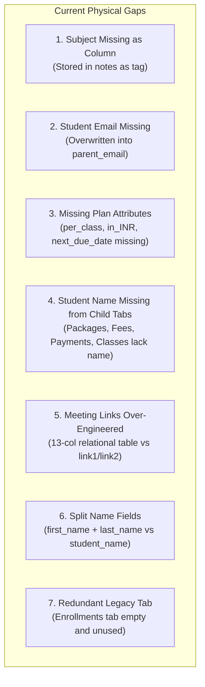
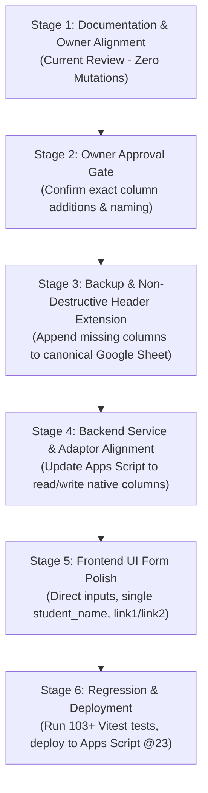

# Personal Dashboard — Requirements-First Field & Schema Reconciliation

**Document Version:** 1.0.0  
**Status:** Requirements & Data Model Review (Read-Only; No Live Rows, Schemas, or Code Changed)  
**Date:** October 21, 2026  
**Canonical Master Spreadsheet ID:** `1cVQknq_Ix-T6igp7c-DwwuYHvgn60fVGbwTGZfGSii8`  
**Current Active Deployment:** Google Apps Script `@22` (`AKfycbx4d_VG4CsZIEAomX_OjNMuej06ktTYmKLME5ennLsI7mx3Fn5b-YBu9CRqe7NwrUVH3w`)

---

## 1. Executive Summary & Purpose

The purpose of this review is to reconcile the Personal Dashboard across all layers against the **original business requirements as the primary source of truth**. 

Over successive technical iterations, the application evolved toward an enterprise-style relational model (12 sheets, UUID-style primary/foreign keys, split name parts, separate link entities, audit logging, and import staging). While functionally operational and backed by 103 passing tests, the physical data model and database schema do not cleanly reflect the simplicity and terminology of a private tutor's direct workflows.

This document:
1. Re-establishes the original requirements in their authentic business meaning.
2. Constructs a comprehensive field-by-field mapping against current physical sheets, backend code, and frontend forms.
3. Identifies every confirmed mismatch, missing column, and design divergence.
4. Proposes the simplest practical data model that satisfies all requirements without unnecessary enterprise machinery.
5. Clarifies billing, fee, and credit terminology with single unambiguous mathematical definitions.
6. Assesses proposed abstractions (specifically rejecting a standalone `PaymentAllocations` table for immediate operations).
7. Provides concrete UI forms, workflows, and a staged non-destructive implementation plan.

---

## 2. Original Requirements Preserved in Their Intended Meaning

The owner's original business requirements define six core functional areas:

```
┌──────────────────────────────────────────────────────────────────────────────────┐
│                         ORIGINAL CORE DATASETS                                   │
├─────────────────────┬──────────────────────────┬─────────────────────────────────┤
│ A. Students         │ B. Package Details       │ C. Meeting Links                │
│ • Student_id        │ • student_id             │ • student_id                    │
│ • Student_name      │ • student_name           │ • student_name                  │
│ • parent_name (opt) │ • plan                   │ • link1 (primary)               │
│ • parent_phone      │ • currency               │ • link2 (backup, opt)           │
│ • student_phone(opt)│ • per_class              │                                 │
│ • parent_email      │ • in_INR                 │                                 │
│ • student_email(opt)│ • classes_purchased      │                                 │
│ • subject           │ • start_date             │                                 │
│ • status            │ • class_consumed         │                                 │
│ • notes             │ • class remaining        │                                 │
│                     │ • next_due_date          │                                 │
├─────────────────────┴──────────────────────────┴─────────────────────────────────┤
│ D. Payment Details                                                               │
│ • student_id, student_name, payment_date, amount                                 │
├──────────────────────────────────────────────────────────────────────────────────┤
│ E. Classes, Scheduling & Attendance                                              │
│ • Scheduling, attendance marking, credit deduction rules, balance tracking       │
├──────────────────────────────────────────────────────────────────────────────────┤
│ F. Fees & Multi-Model Billing                                                    │
│ • Monthly, yearly, per-class, and prepaid packages                               │
│ • One-click monthly invoice generator with preview and duplicate protection      │
└──────────────────────────────────────────────────────────────────────────────────┘
```

### Explicit Owner Decisions Reconciled
Where subsequent owner decisions clarified implementation details, they are acknowledged as follows:
1. **Spreadsheet Tabs:** The owner approved consolidating daily operations into 6 working tabs (`Students`, `Packages`, `ClassSessions`, `FeeObligations`, `Payments`, `MeetingLinks`), hiding operational tabs (`AuditLog`, `ImportBatches`, `ImportRowResults`, `AppConfig`), and preserving `Enrollments` unchanged during transition.
2. **Monthly Invoicing:** One-click monthly generation with candidate preview, duplicate detection, and explicit confirmation before fee obligations are committed.
3. **Attendance & Credit Policies:**
   - Completed class (`ATTENDED`): Deducts 1 package credit (`CONSUME`).
   - Unexcused no-show (`NO_SHOW` / `ABSENT_UNEXCUSED`): Deducts 1 package credit (`CONSUME`).
   - Excused absence (`EXCUSED` / `ABSENT_EXCUSED`): Preserves package credit (`NO_CONSUME`).
   - Advance cancellation ($\ge 4$ hours notice): Preserves package credit (`NO_CONSUME`).
   - Late cancellation ($< 4$ hours notice): Deducts 1 credit (`CONSUME`) unless tutor explicitly waives penalty (`NO_CONSUME`).
   - Administrative credit restoration: Idempotently restores credit via audited `CREDIT_BACK` record.
4. **Overpayment Tracking:** Excess payments are recognized as unapplied student credits toward future fees, strictly isolated by currency. Cash receipts must never be double-counted.

---

## 3. Requirements-to-Schema Field-by-Field Mapping

Below is the definitive mapping of every required field from the original requirements against the actual physical spreadsheet headers, backend adaptors, and frontend forms.

### Dataset A: Students (10 Required Fields)

| Original Field | Business Meaning | Current Physical Tab & Column | Current Frontend Field & Form | Current Backend Mapping & Behavior | Status | Required Action | Reason for Additional Field / Rule |
|---|---|---|---|---|---|---|---|
| `Student_id` | Unique identifier for student record | `Students` $\rightarrow$ `student_id` (Col 1) | `student.student_id`, displayed in Profile | Generated via `generateStudentId()` (`stu_...`), indexed in repository | **Exact Match** | Retain | Primary foreign key relationship across all child tables. |
| `Student_name` | Full display name of student | `Students` $\rightarrow$ `first_name` (Col 2), `last_name` (Col 3) | `full_name` in `StudentForm.tsx` | Split on whitespace into `first_name` + `last_name` on write; concatenated on read | **Renamed / Split** | Merge physical columns to `student_name` | Splitting causes friction for single names, patronymics, and multi-part names. Single `student_name` matches requirement. |
| `parent_name` | Primary parent/guardian name | `Students` $\rightarrow$ `parent_guardian_name` (Col 6) | `parent_name` in `StudentForm.tsx` | Mapped 1:1 to `parent_guardian_name` in `StudentService.gs` | **Renamed** | Rename column to `parent_name` | Direct terminology alignment with owner requirements. |
| `parent_phone` | Parent phone (WhatsApp / Call) | `Students` $\rightarrow$ `primary_phone` (Col 8) | `parent_phone` in `StudentForm.tsx` | Mapped to `primary_phone` in `StudentService.gs` | **Renamed** | Rename column to `parent_phone` | Eliminates ambiguity over whether primary phone belongs to parent or student. |
| `student_phone` | Direct student mobile phone | `Students` $\rightarrow$ `secondary_phone` (Col 9) | `phone` in `StudentForm.tsx` | Mapped to `secondary_phone` in `StudentService.gs` | **Renamed** | Rename column to `student_phone` | Clarifies that secondary phone is specifically the student's direct mobile line. |
| `parent_email` | Parent email for fee billing | `Students` $\rightarrow$ `parent_email` (Col 10) | `parent_email` in `StudentForm.tsx` | Stored directly in `parent_email` column | **Exact Match** | Retain | Essential for billing receipts and guardian communication. |
| `student_email` | Direct student email for calendar invites | **MISSING** from `Students` sheet | `email` in `StudentForm.tsx` (overwrites parent email) | Frontend `email` aliased to `parent_email` in `StudentService.gs`; student email lost | **Missing** | Add `student_email` column to `Students` | Student needs calendar invites; parent needs invoices. Merging them corrupts communication channels. |
| `subject` | Primary academic subject(s) studied | **MISSING** as physical column | `subject` in `StudentForm.tsx` | Encoded into `internal_summary` via regex tag `[Subject: <text>]\n<notes>` | **Workaround (Tag in Notes)** | Add dedicated `subject` column | Essential tutoring attribute; storing as embedded text tag is fragile and prevents sheet filtering/sorting. |
| `status` | Student lifecycle status (`ACTIVE` / `INACTIVE`) | `Students` $\rightarrow$ `student_status` (Col 12) | `status` in Directory & Profile | Stored as `student_status`; drives archival and directory queries | **Renamed** | Rename column to `status` | Direct terminology alignment. |
| `notes` | Background context, goals, preferences | `Students` $\rightarrow$ `internal_summary` (Col 15) | `notes` in `StudentForm.tsx` | Strips `[Subject: ...]` tag on read and prepends on write | **Renamed / Combined** | Rename column to `notes` | Separating `subject` leaves `notes` as clean free-form text. |

### Dataset B: Package Details & Multi-Model Billing (11 Required Fields)

| Original Field | Business Meaning | Current Physical Tab & Column | Current Frontend Field & Form | Current Backend Mapping & Behavior | Status | Required Action | Reason for Additional Field / Rule |
|---|---|---|---|---|---|---|---|
| `student_id` | Foreign key referencing Student | `Packages` $\rightarrow$ `student_id` (Col 2) | Selected via dropdown in `PackageForm.tsx` | Stored in `Packages.student_id` | **Exact Match** | Retain | Relational integrity link. |
| `student_name` | Student full name for direct sheet readability | **MISSING** from `Packages` sheet | Displayed dynamically in UI via student join | Only stored in `Students`; missing from physical sheet | **Missing from Sheet** | Add `student_name` column to `Packages` | When owner opens Google Sheets, rows without student name require manual cross-referencing. |
| `plan` | Billing model / package title | `Packages` $\rightarrow$ `package_name` (Col 4) | `package_name` in `PackageForm.tsx` | Free-text string; no explicit enum for billing model | **Partially Mapped** | Add `plan_type` (`PACKAGE`, `MONTHLY`, `YEARLY`, `PER_CLASS`) | Distinguishes prepaid credit blocks from recurring monthly/yearly plans and per-class billing. |
| `currency` | Currency of pricing (`INR`, `USD`, etc.) | `Packages` $\rightarrow$ `currency` (Col 7) | `currency` dropdown (`INR`, `USD`, `EUR`, `GBP`) | Stored directly; defaults to `INR` | **Exact Match** | Retain | Supports overseas students with strict financial isolation. |
| `per_class` | Cost per individual class session | **MISSING** from `Packages` sheet | `price / total_classes` computed on UI | Not persisted as physical column | **Missing** | Add `per_class` column to `Packages` | Required for per-class billing calculations, pro-rata package refunds, and hourly rate tracking. |
| `in_INR` | INR equivalent value for foreign currency agreements | **MISSING** from `Packages` sheet | Not present in UI | Not calculated or stored | **Missing** | Add `in_INR` (optional/computed) | Required when tutor needs tax/local revenue reporting for foreign currency tuition (e.g. $40/class = ₹3,300). |
| `classes_purchased` | Total class credits in block / planned per period | `Packages` $\rightarrow$ `purchased_classes` (Col 5) | `total_classes` in `PackageForm.tsx` | Stored in `purchased_classes` column | **Renamed** | Rename column to `classes_purchased` | Direct terminology match. |
| `start_date` | Date learning block / billing agreement begins | `Packages` $\rightarrow$ `start_date` (Col 9) | `start_date` in `PackageForm.tsx` | Stored as ISO YYYY-MM-DD | **Exact Match** | Retain | Boundary for attendance counting and invoice scheduling. |
| `class_consumed` | Number of class credits used to date | **DERIVED** (Not stored as static column) | `consumed_classes` on Package Card | Calculated in `PackageService.gs` by summing `ClassSessions` where `class_credit_effect = 'CONSUME'` minus `CREDIT_BACK` | **Derived (Authoritative)** | Keep Derived; display in UI & export | Storing static integer causes drift if attendance is edited, cancelled, or backfilled. Derivation is strictly correct. |
| `class remaining` | Remaining balance of class credits | **DERIVED** (Not stored as static column) | `remaining_classes` on Package Card | Calculated in `PackageService.gs`: $\max(0, \text{purchased} - \text{consumed})$ | **Derived (Authoritative)** | Keep Derived; display in UI & export | Dynamically derived from attendance prevents balance desynchronization. |
| `next_due_date` | Date when next invoice or package renewal is expected | **MISSING** from `Packages` sheet | Only exists on `FeeObligations.due_date` | Not present on package/plan entity | **Missing** | Add `next_due_date` column to `Packages` | Essential for monthly/yearly recurring plans and renewal alerts when package credits run low. |

### Dataset C: Meeting Links (4 Required Fields)

| Original Field | Business Meaning | Current Physical Tab & Column | Current Frontend Field & Form | Current Backend Mapping & Behavior | Status | Required Action | Reason for Additional Field / Rule |
|---|---|---|---|---|---|---|---|
| `student_id` | Foreign key referencing Student | `MeetingLinks` $\rightarrow$ `student_id` (Col 2) | Dropdown in `MeetingLinkForm.tsx` | Stored in relational row | **Exact Match** | Retain or embed in `Students` | Identifies whose class link this is. |
| `student_name` | Student display name | **MISSING** from `MeetingLinks` sheet | Displayed via student lookup in UI | Not stored in physical sheet | **Missing from Sheet** | Add `student_name` or embed in `Students` | Sheet readability. |
| `link1` | Primary meeting room URL (e.g. Google Meet) | `MeetingLinks` $\rightarrow$ `meeting_url` where `is_preferred = true` | `meeting_url` in `MeetingLinkForm.tsx` | Relational 1:N table with 13 columns per link (`provider`, `link_label`, `is_preferred`, etc.) | **Over-Engineered** | Simplify to `link1` (Primary Link) | Original requirement is simply primary link (`link1`) and backup (`link2`). 13-column relational table is unnecessary. |
| `link2` | Backup meeting room URL (e.g. Zoom) | `MeetingLinks` $\rightarrow$ second row where `is_preferred = false` | Second entry in `MeetingLinkForm.tsx` | Separate row in `MeetingLinks` table | **Over-Engineered** | Simplify to `link2` (Backup Link) | Having two explicit columns (`link1`, `link2`) on student or a 4-column table matches requirements cleanly. |

### Dataset D: Payment Details (4 Required Fields + Essential Technical Fields)

| Original Field | Business Meaning | Current Physical Tab & Column | Current Frontend Field & Form | Current Backend Mapping & Behavior | Status | Required Action | Reason for Additional Field / Rule |
|---|---|---|---|---|---|---|---|
| `student_id` | Foreign key referencing Student | `Payments` $\rightarrow$ `student_id` (Col 2) | Dropdown in `PaymentForm.tsx` | Stored directly in `Payments.student_id` | **Exact Match** | Retain | Links cash receipt to student ledger. |
| `student_name` | Student display name | **MISSING** from `Payments` sheet | Displayed in UI via join | Not stored in physical sheet | **Missing from Sheet** | Add `student_name` column to `Payments` | Invaluable when owner opens sheet directly or exports payments for accounting/tax filing. |
| `payment_date` | Date payment received in bank/cash | `Payments` $\rightarrow$ `payment_date` (Col 4) | `payment_date` in `PaymentForm.tsx` | Stored as ISO YYYY-MM-DD | **Exact Match** | Retain | Primary accounting transaction date. |
| `amount` | Cash amount received | `Payments` $\rightarrow$ `amount` (Col 5) | `amount` in `PaymentForm.tsx` | Stored as numeric cash receipt | **Exact Match** | Retain | Authoritative bank receipt amount. |
| *(Technical)* `payment_id` | Unique transaction ID | `Payments` $\rightarrow$ `payment_id` (Col 1) | Displayed in ledger table | Generated via `generatePaymentId()` | **Technical Field** | Retain | Immutable transaction reference for auditability. |
| *(Technical)* `fee_id` | Associated fee obligation / invoice | `Payments` $\rightarrow$ `fee_obligation_id` (Col 3) | Dropdown in `PaymentForm.tsx` | Links payment to fee obligation | **Technical Field** | Retain | Enables partial payment tracking and invoice closure. |
| *(Technical)* `currency` | Currency of payment (`INR`, `USD`) | `Payments` $\rightarrow$ `currency` (Col 6) | Inferred from fee obligation | Stored directly; defaults to `INR` | **Technical Field** | Retain | Prevents cross-currency contamination in financial reports. |
| *(Technical)* `payment_method` | Bank channel (`UPI`, `BANK_TRANSFER`, `CASH`) | `Payments` $\rightarrow$ `payment_method` (Col 7) | Dropdown in `PaymentForm.tsx` | Stored directly | **Technical Field** | Retain | Essential for bank reconciliation and tax categorization. |
| *(Technical)* `transaction_reference` | UPI UTR / Bank Ref / Cheque # | `Payments` $\rightarrow$ `transaction_reference` (Col 8) | Text input in `PaymentForm.tsx` | Stored directly (optional) | **Technical Field** | Retain | Invaluable for locating bank transactions on statements. |
| *(Technical)* `payment_status` | Status (`RECORDED`, `VOID`) | `Payments` $\rightarrow$ `payment_status` (Col 10) | Status badge in Ledger | Stored directly; allows audited reversal | **Technical Field** | Retain | Eliminates physical row deletion while allowing error correction. |

### Dataset E: Classes, Scheduling & Attendance

| Requirement | Business Meaning | Current Physical Tab & Column | Current Frontend Implementation | Current Backend Implementation | Status | Required Action |
|---|---|---|---|---|---|---|
| Class Scheduling | Schedule upcoming lesson | `ClassSessions` $\rightarrow$ `scheduled_start`, `scheduled_end`, `class_title` | `ClassScheduleForm.tsx`: date, time, duration, topic | `Classes_schedule` in `ClassService.gs` creates record with `PENDING` effect | **Correctly Implemented** | Retain; add `student_name` |
| Attendance Tracking | Record who attended | `ClassSessions` $\rightarrow$ `attendance_status`, `session_status` | `AttendanceControl.tsx`: Attended, No-Show, Cancel | `Classes_complete` in `ClassService.gs` | **Correctly Implemented** | Retain |
| Credit Deduction | Deduct 1 package credit for attendance or unexcused absence | `ClassSessions` $\rightarrow$ `class_credit_effect` (`CONSUME`, `NO_CONSUME`, `CREDIT_BACK`) | Visual indicator on session card | `ClassService.gs`: `ATTENDED` and `NO_SHOW` $\rightarrow$ `CONSUME`; `EXCUSED` and waived late cancel $\rightarrow$ `NO_CONSUME` | **Correctly Implemented** | Retain |
| Remaining Credits | Available class credits | Derived: `purchased - consumed + restored` | `PackageCard.tsx`, `OverviewWidget.tsx` | `PackageService.gs: Packages_enrichWithBalance` | **Correctly Implemented** | Retain dynamic calculation |

### Dataset F: Fees & Billing

| Requirement | Business Meaning | Current Physical Tab & Column | Current Frontend Implementation | Current Backend Implementation | Status | Required Action |
|---|---|---|---|---|---|---|
| Multi-Model Invoicing | Bill monthly, yearly, per-class, or package | `FeeObligations` $\rightarrow$ `obligation_description`, `amount_due`, `due_date` | `FeeObligationForm.tsx` | `FeeService.gs: FeeObligations_create` | **Correctly Implemented** | Retain; add `student_name` and `plan_type` |
| Monthly Invoicing | One-click monthly billing run | `FeeObligations` tab | `MonthlyInvoiceModal.tsx` | `monthlyInvoiceGenerator.ts` + `FeeService.gs` with concurrency lock and duplicate lookup | **Correctly Implemented** | Retain |
| Partial Payments | Accept multiple payments per fee | Multiple `Payments` rows pointing to one `fee_obligation_id` | Balance displayed dynamically on fee item | `FeeService.gs: FeeObligations_enrichWithBalances` caps paid amount at `amount_due` | **Correctly Implemented** | Retain |
| Overpayment Credit | Track unapplied surplus | Derived across payments and fees | `AvailableCreditBadge.tsx` | `creditCalculator.ts`: unapplied credit grouped strictly by currency | **Correctly Implemented** | Retain |

---

## 4. Current Mismatches and Confirmed Defects

Inspecting the live physical schema and code reveals 9 concrete mismatches between the current implementation and the original requirements:



### 1. Subject Stored in `internal_summary` Rather than Dedicated Column
- **Defect:** `Students` sheet has no `subject` column. The application stores it as an encoded tag: `[Subject: Mathematics]\nStudent notes`.
- **Consequence:** In Google Sheets, the tutor cannot sort, filter, or group students by subject. Regex parsing in code introduces risk if tags are malformed.
- **Fix:** Add dedicated `subject` column to `Students`.

### 2. Student Email Completely Missing from Physical Schema
- **Defect:** `Students` sheet has only `parent_email`. When the user enters a student email in the UI, the backend currently maps it to `parent_email`, destroying the distinction.
- **Consequence:** Cannot send calendar invites to student while sending invoices to parent.
- **Fix:** Add dedicated `student_email` column to `Students`.

### 3. Missing Package / Plan Fields: `per_class`, `in_INR`, `next_due_date`
- **Defect:** `Packages` sheet contains `package_price` and `purchased_classes`, but lacks `per_class` rate, `in_INR` conversion rate, and `next_due_date`.
- **Consequence:** The tutor cannot record the agreed hourly/per-class rate, cannot see when the next payment is due directly on the package, and has no field for INR equivalents of foreign payments.
- **Fix:** Add `per_class`, `in_INR`, and `next_due_date` columns to `Packages`.

### 4. `student_name` Omitted from All Related Child Sheets
- **Defect:** `Packages`, `ClassSessions`, `FeeObligations`, `Payments`, and `MeetingLinks` contain only `student_id`.
- **Consequence:** When opening Google Sheets directly in a browser, the tutor sees cryptic IDs (`stu_k92j8fms01`) instead of the student's name, forcing constant cross-tab lookups.
- **Fix:** Populate human-readable `student_name` automatically on row insertion across all child sheets.

### 5. `MeetingLinks` Over-Engineered into a 13-Column Relational Table
- **Defect:** The original requirement is simply `student_id`, `student_name`, `link1`, `link2`. The system built a separate 13-column table with provider enums, preferred flags, validity dates, deactivation timestamps, and an extra management UI.
- **Consequence:** Unnecessary cognitive overhead and friction for a solo tutor who just needs to store and launch Google Meet or Zoom links.
- **Fix:** Either embed `link1` and `link2` directly onto `Students`, or reduce `MeetingLinks` to a simple 4-column reference table (`student_id`, `student_name`, `link1`, `link2`).

### 6. Student Name Split into `first_name` and `last_name`
- **Defect:** Physical `Students` sheet has separate `first_name` and `last_name` columns, requiring artificial string splitting and joining.
- **Consequence:** Unnatural for single names or complex multi-word naming conventions.
- **Fix:** Unify into a single `student_name` column.

### 7. Redundant `Enrollments` Entity Still Lingering
- **Defect:** The spreadsheet still contains an `Enrollments` tab (11 columns, 0 data rows) alongside `Packages`.
- **Consequence:** Confusion about whether course agreements belong in `Enrollments` or `Packages`.
- **Fix:** Formally consolidate into `Packages` and deprecate `Enrollments`.

---

## 5. Recommended Simplest Practical Schema

To eliminate unnecessary enterprise complexity while preserving accounting correctness and auditability, we compare two options:

### Option A: The Ultra-Minimal 5-Tab Architecture (Recommended for New Installations)
Eliminates separate `MeetingLinks` and `Enrollments` tabs entirely by embedding `link1` and `link2` directly on `Students`:

```
Ultra-Minimal Working Tabs (5 Visible):
├── 1. Students          [student_id, student_name, parent_name, parent_phone, student_phone, parent_email, student_email, subject, status, link1, link2, notes]
├── 2. Packages          [package_id, student_id, student_name, plan, currency, per_class, in_INR, classes_purchased, start_date, next_due_date, status, notes]
├── 3. ClassSessions     [class_id, student_id, student_name, package_id, class_date, start_time, duration_minutes, topic, attendance_status, credit_effect, notes]
├── 4. FeeObligations    [fee_id, student_id, student_name, package_id, description, amount_due, currency, due_date, status, notes]
└── 5. Payments          [payment_id, student_id, student_name, fee_id, payment_date, amount, currency, payment_method, reference, status, notes]

Hidden Operational Tabs (3):
├── [AuditLog]           (Immutable forensic mutation trail)
├── [AppConfig]          (Schema version & system flags)
└── [ImportBatches]      (CSV staging buffer)
```

### Option B: The Pragmatic 6-Tab Architecture (Recommended for Zero-Risk In-Place Upgrade)
Preserves the current 6 working tabs approved by the owner, adding the missing required columns while avoiding tab re-indexing:

```
Pragmatic Working Tabs (6 Visible):
├── 1. Students          [student_id, student_name, parent_name, parent_phone, student_phone, parent_email, student_email, subject, status, notes, created_at, updated_at]
├── 2. Packages          [package_id, student_id, student_name, plan_name, plan_type, currency, per_class, in_INR, classes_purchased, start_date, next_due_date, status, notes]
├── 3. ClassSessions     [class_session_id, student_id, student_name, package_id, meeting_link_id, class_title, scheduled_start, scheduled_end, session_status, attendance_status, class_credit_effect, cancellation_reason, notes]
├── 4. FeeObligations    [fee_obligation_id, student_id, student_name, package_id, obligation_description, amount_due, currency, due_date, obligation_status, notes]
├── 5. Payments          [payment_id, student_id, student_name, fee_obligation_id, payment_date, amount, currency, payment_method, transaction_reference, idempotency_key, payment_status, notes]
└── 6. MeetingLinks      [meeting_link_id, student_id, student_name, link_label, meeting_url, provider, is_preferred, link_status]
```

### Reassessment of `PaymentAllocations` Table: GENUINELY UNNECESSARY
In Phase 13, a separate `PaymentAllocations` sub-ledger table was explored to handle split payments. 

**Definitive Recommendation: DO NOT ADD `PaymentAllocations`.**
- **Why it was proposed:** In corporate ERP systems, multiple payments are split across multiple open invoices via junction allocation rows.
- **Why a solo tutor does NOT need it:** A solo tutor invoices on a predictable monthly, per-package, or per-class basis. Parents typically transfer the exact fee, pay partially, or round up (e.g. paying ₹6,000 for a ₹5,000 fee).
- **How unapplied credit is handled simply without a new table:**
  1. Payment is recorded for the actual cash received (₹6,000) against the fee obligation (`amount_due = 5000`).
  2. The fee applied amount is capped at `amount_due` (₹5,000), leaving the fee 100% paid.
  3. The remaining ₹1,000 is automatically recognized as student unapplied credit:
     $$\text{Unapplied Credit} = \sum \text{Payments.amount} - \sum \text{FeeObligations.paid\_amount}$$
  4. When the tutor generates the next month's invoice (₹5,000), the generator automatically shows:
     - Gross Invoice: ₹5,000
     - Applied Credit: -₹1,000
     - Net Amount Due: ₹4,000
  5. The net fee obligation is issued for ₹4,000.
  6. **Result:** Zero double-counting of cash receipts in financial reports, zero extra database tables, and zero complex allocation UI for the tutor.

---

## 6. Unambiguous Billing and Credit Terminology

To prevent any confusion between package pricing, hourly rates, invoices, and cash receipts, the following definitions are authoritative:

| Term | Mathematical Definition / Meaning | Input vs Calculated | Where Stored |
|---|---|---|---|
| **Package Price** | Total financial cost charged for a class package block (e.g. ₹10,000 for 10 classes). | Entered by Tutor | `Packages.package_price` |
| **Per-Class Rate** | Individual lesson rate (e.g. ₹1,000/class, $35/class). Crucial for per-class billing. | Entered or Derived (`price / classes`) | `Packages.per_class` |
| **Currency** | Currency of agreed fees and payments (`INR`, `USD`, `EUR`, `GBP`). | Entered by Tutor | `Packages.currency`, `FeeObligations.currency`, `Payments.currency` |
| **INR Equivalent (`in_INR`)** | Baseline INR conversion of foreign fee for local tax/revenue reporting. | Entered or Derived (`foreign_amount * fx_rate`) | `Packages.in_INR` |
| **Classes Purchased** | Total number of class credits bought in a prepaid block or agreed per period. | Entered by Tutor | `Packages.classes_purchased` |
| **Classes Consumed** | Number of class credits used by attended sessions or unexcused no-shows: $\sum (\text{effect} = \text{CONSUME}) - \sum (\text{effect} = \text{CREDIT\_BACK})$ | **Calculated** dynamically from attendance | Derived from `ClassSessions`; never stored as static integer |
| **Classes Remaining** | Unused class credits remaining on the package: $\max(0, \text{classes\_purchased} - \text{classes\_consumed})$ | **Calculated** dynamically | Derived from `Packages` & `ClassSessions`; never edited independently |
| **Fee Amount Due** | Financial invoice obligation issued to parent/student for payment. | Entered by Tutor or generated by monthly invoice generator | `FeeObligations.amount_due` |
| **Payment Received** | Actual cash receipt collected in tutor's bank account or UPI. | Entered by Tutor from bank alert | `Payments.amount` |
| **Amount Applied to Fee** | Portioned cash applied to settle a specific fee obligation: $\min(\text{payment\_amount}, \text{fee\_amount\_due})$ | **Calculated** dynamically | Derived in `FeeService.gs`; capped at `amount_due` |
| **Unapplied Credit** | Excess money received from parent beyond all billed fees: $\max(0, \sum \text{Payments.amount} - \sum \text{FeeObligations.paid\_amount})$ | **Calculated** dynamically | Derived per currency in `creditCalculator.ts`; offsets future invoices |
| **Outstanding Balance** | Unpaid fee amount remaining on an invoice: $\max(0, \text{amount\_due} - \text{amount\_applied})$ | **Calculated** dynamically | Derived on `FeeObligations` |
| **Next Payment Due Date** | Calendar date when next payment or package renewal is expected. | Entered by Tutor or auto-calculated (+1 month) | `Packages.next_due_date` and `FeeObligations.due_date` |

> [!IMPORTANT]
> **Financial Reporting Cash Receipt Invariant:**  
> Total cash income in financial reports is ALWAYS calculated strictly as:
> $$\text{Total Income} = \sum_{\text{payment\_status} \neq \text{'VOID'}} \text{Payments.amount}$$
> Excess payments are never re-inserted as second payment rows. They are credited forward on future invoice obligations, guaranteeing that reported receipts match actual bank deposits 100%.

---

## 7. Owner-Facing Forms & Streamlined Workflows

The interface must keep routine tutoring tasks fast, short, and free of duplicate data entry.

### Workflow 1: Add or Edit Student
- **Screen:** `Students` $\rightarrow$ "Add Student" Modal
- **Visible Fields to Owner:**
  - `Student Name` (Required, text)
  - `Subject` (Required, text or dropdown, e.g. "Mathematics", "Physics")
  - `Parent Name` (Optional, text)
  - `Parent Phone` (Required, tel — for WhatsApp coordination)
  - `Parent Email` (Required, email — for invoices)
  - `Student Phone` (Optional, tel)
  - `Student Email` (Optional, email — for class calendar invites)
  - `Primary Meeting Link` (Optional, URL — e.g. Google Meet)
  - `Backup Meeting Link` (Optional, URL — e.g. Zoom)
  - `Notes` (Optional, multiline text)
- **Auto-Populated:** `student_id` (system generated), `status` (`ACTIVE`).
- **Owner Action:** Enter student and parent contacts once $\rightarrow$ click "Save Student".

### Workflow 2: Assign Package / Billing Arrangement
- **Screen:** `Packages` $\rightarrow$ "New Package" Modal (or from Student Profile)
- **Visible Fields to Owner:**
  - `Student` (Auto-selected if on profile, else dropdown)
  - `Billing Model / Plan Type` (Dropdown: `Prepaid Package`, `Monthly`, `Yearly`, `Per-Class`)
  - `Plan Name` (Text, e.g. "Grade 10 Math — 10 Classes")
  - `Total Classes` (Number, e.g. 10; optional for monthly/per-class)
  - `Total Price` (Number, e.g. ₹10,000)
  - `Currency` (Dropdown: `INR`, `USD`, `EUR`, `GBP`; defaults to `INR`)
  - `Start Date` (Date picker, defaults to today)
  - `Next Due Date` (Date picker, defaults to +1 month)
- **Calculated on Form:** `Per-Class Rate` ($\text{Price} / \text{Classes} = ₹1,000/\text{class}$).
- **Owner Action:** Select plan type, enter price and class count $\rightarrow$ click "Create Package".

### Workflow 3: Schedule a Class Session
- **Screen:** `Classes` $\rightarrow$ "Schedule Class" Modal
- **Visible Fields to Owner:**
  - `Student` (Dropdown)
  - `Topic / Title` (Text, e.g. "Trigonometry - Exercise 3.2")
  - `Date & Start Time` (Date & time picker)
  - `Duration` (Dropdown: 30, 45, 60, 90 mins; defaults to 60)
  - `Meeting Link` (Auto-populated with student's primary link; editable override)
- **Auto-Populated:** Active `package_id` for that student.
- **Owner Action:** Pick student, pick date/time $\rightarrow$ click "Schedule".

### Workflow 4: Record Attendance & Credit Accounting
- **Screen:** `Classes` $\rightarrow$ Session Card / Row
- **Visible Controls:** Three one-click buttons:
  - `Attended` $\rightarrow$ Marks `ATTENDED`, deducts 1 credit (`CONSUME`).
  - `No-Show` $\rightarrow$ Marks `ABSENT_UNEXCUSED`, deducts 1 credit (`CONSUME`).
  - `Cancel` $\rightarrow$ Opens prompt:
    - If $\ge 4$ hours notice: Preserves credit (`NO_CONSUME`).
    - If $< 4$ hours notice: Shows checkbox *"Waive cancellation penalty?"*. If checked $\rightarrow$ `NO_CONSUME`; if unchecked $\rightarrow$ `CONSUME`.
  - `Restore Credit` (Available on completed sessions) $\rightarrow$ Restores 1 consumed credit (`CREDIT_BACK`) with an audit reason.
- **Owner Action:** Click one button after class.

### Workflow 5: Monthly Invoicing (One-Click)
- **Screen:** `Fees` $\rightarrow$ "Generate Monthly Invoices" Button
- **Owner Action:**
  1. Click "Generate Monthly Invoices".
  2. Select billing month (e.g. "March 2026").
  3. Modal displays table of candidates:
     - Student Name
     - Billing Plan (`Monthly Recurring` or `Per-Class in Arrears`)
     - Classes Attended in Month (for per-class billing)
     - Unapplied Credit deduction (e.g. -₹1,000)
     - Net Amount Due
     - Status: `Ready to Incur` or `Duplicate (Already Generated)`
  4. Tutor reviews preview and clicks "Confirm & Create Invoices".
- **Backend Safety:** Wrapped in concurrency lock; duplicate protection prevents double-billing even on double-clicks or retries.

### Workflow 6: Record Payment
- **Screen:** `Payments` $\rightarrow$ "Record Payment" Modal (or click "Pay" on Fee row)
- **Visible Fields to Owner:**
  - `Student` (Auto-populated from fee)
  - `Fee Obligation / Invoice` (Dropdown showing description and outstanding balance)
  - `Payment Date` (Date picker, defaults to today)
  - `Amount Received` (Number, defaults to outstanding balance)
  - `Payment Method` (Dropdown: `UPI`, `Bank Transfer`, `Cash`, `Card`)
  - `Transaction Reference / UTR` (Optional text, e.g. UPI ref #)
  - `Notes` (Optional text)
- **Calculated Display:** Remaining fee balance after payment; any overpayment highlighted as future student credit.
- **Owner Action:** Enter amount and payment method $\rightarrow$ click "Record Payment".

---

## 8. Extra Fields and Tables: Concrete Justification

Every field and table in the system beyond the basic requirements must justify its existence:

### Additional Tables Justification
| Table Name | Classification | Business Problem It Solves | Why Existing Tables Cannot Solve It | Essential Now vs Deferred | User Effort Added |
|---|---|---|---|---|---|
| `FeeObligations` | Essential Working Tab | Invoicing demands must be separated from cash collections. Allows tracking what was billed, when it was due, and whether it was paid in full or partially. | Merging into `Students` or `Packages` destroys partial payment history and periodic monthly billing records. | **Essential Now** | Minimal: created once per month or package. |
| `ClassSessions` | Essential Working Tab | Tracks scheduling, lesson topics, attendance dates, and individual credit consumption events. | `Packages` only tracks a static aggregate counter; cannot track attendance dates or audit disputes. | **Essential Now** | 1 click per class to mark attendance. |
| `Payments` | Essential Working Tab | Immutable cash ledger. Proves when money was received, through which bank method, and for which invoice. | Merging into `FeeObligations` destroys multiple partial payment records. | **Essential Now** | 1 form per received payment. |
| `StudentNotes` | Operational / Context | Chronological log of academic follow-ups, parent feedback, and homework reminders. | Student profile notes are static; cannot track dated follow-up logs over time. | **Essential Now** | Optional; used when tutor needs to log progress. |
| `AuditLog` | Hidden Operational | Forensic log of all administrative actions (create, edit, void, archive) with timestamps and actor emails. | Application tables only show current state; audit log proves historical changes. | **Essential Now (Hidden)** | **Zero user effort** (automatic backend logging). |
| `AppConfig` | Hidden Operational | Stores schema version, maintenance flags, and system settings. | Prevents hardcoding system metadata into code. | **Essential Now (Hidden)** | **Zero user effort**. |
| `ImportBatches` & `ImportRowResults` | Hidden Operational | Staging logs for CSV import reconciliation and error diagnostics. | Required during bulk migration so failed rows can be identified without corrupting live tables. | **Essential Now (Hidden)** | **Zero user effort**. |
| `Enrollments` | Legacy Tab | Historical formal course boundary. | Redundant with `Packages` in solo tutoring. | **Deferred / Candidate for Removal** | Currently zero effort (retained empty). |
| `PaymentAllocations` | Proposed Sub-Ledger | Splitting single bank payments across multiple invoices. | Solved cleanly via credit forward invoicing without extra table. | **REJECTED / DO NOT ADD** | High effort (requires managing split rows). |

### Additional Columns Justification
| Additional Column | Table | Why It Is Essential / What Breaks Without It |
|---|---|---|
| `currency` | `Packages`, `FeeObligations`, `Payments` | Foreign students pay in USD/EUR/GBP. Without currency isolation, $500 would be treated as ₹500, or USD overpayments would offset INR fees. |
| `payment_method` | `Payments` | Distinguishes cash from UPI and bank transfers. Without it, tax categorization and bank reconciliation are impossible. |
| `transaction_reference` | `Payments` | UPI UTR / Bank transfer reference. Without it, the tutor cannot locate the transaction on a bank statement when a parent disputes payment. |
| `idempotency_key` | `Payments`, `FeeObligations` | Prevents duplicate payments or invoices if the tutor double-clicks or experiences a network timeout. |
| `payment_status` / `void_reason` | `Payments`, `FeeObligations` | Allows reversing a mistaken payment or invoice while preserving a permanent audit trail. Deleting rows destroys financial accountability. |
| `class_credit_effect` | `ClassSessions` | Distinguishes classes that deduct credit (`CONSUME`) from excused absences (`NO_CONSUME`) and restorations (`CREDIT_BACK`). Prevents credit balance desynchronization. |
| `cancellation_reason` | `ClassSessions` | Proves why a class was cancelled and whether the 4-hour cancellation rule was properly applied or waived. |

---

## 9. Fields and Tables to Remove, Merge, Rename, or Derive

### 1. Tables to Remove or Defer
- **`PaymentAllocations` (Proposed):** **DO NOT ADD.** Overpayment credit is derived authoritatively and credited forward on future invoices.
- **`Enrollments` (Tab):** **DEPRECATE.** Completely redundant with `Packages`. Can be archived or dropped once owner authorizes.
- **`MeetingLinks` (Tab):** **SIMPLIFY or MERGE.** Can either be reduced to 4 columns (`student_id`, `student_name`, `link1`, `link2`) or embedded directly as `link1` and `link2` on the `Students` table.

### 2. Physical Columns to Add to Live Google Sheet
- **`Students`:** Add `student_email` and `subject`.
- **`Packages`:** Add `per_class`, `in_INR`, and `next_due_date`.
- **All Child Sheets (`Packages`, `ClassSessions`, `FeeObligations`, `Payments`):** Add `student_name` so the spreadsheet is directly readable in Google Sheets without foreign-key lookups.

### 3. Fields That Must Remain Derived (Never Stored as Static Columns)
- **`class_consumed`:** Derived dynamically by summing qualifying sessions in `ClassSessions`. Storing a static integer invites balance drift.
- **`class remaining`:** Derived dynamically as $\text{purchased} - \text{consumed} + \text{restored}$.
- **`paid_amount` & `outstanding_balance`:** Derived dynamically on `FeeObligations` from non-void `Payments`.
- **`unapplied_credit`:** Derived dynamically per currency from non-void payments and obligations.

---

## 10. Required Changes vs Optional Future Enhancements

```
┌──────────────────────────────────────────────────────────────────────────────────┐
│ PHASE 1: IMMEDIATE REQUIRED CHANGES (Must be resolved before real student data)   │
├──────────────────────────────────────────────────────────────────────────────────┤
│ 1. Add physical `subject` column to `Students` sheet.                            │
│ 2. Add physical `student_email` column to `Students` sheet.                      │
│ 3. Add physical `per_class` and `next_due_date` columns to `Packages` sheet.     │
│ 4. Add `student_name` column to child sheets for direct readability.             │
│ 5. Unify `first_name` and `last_name` into `student_name` on `Students`.         │
│ 6. Standardize frontend and backend parameter naming to match original terms.     │
└──────────────────────────────────────────────────────────────────────────────────┘
                                         ▼
┌──────────────────────────────────────────────────────────────────────────────────┐
│ PHASE 2: OPTIONAL FUTURE ENHANCEMENTS (Can be deferred without blocking launch)  │
├──────────────────────────────────────────────────────────────────────────────────┤
│ 1. Consolidate `MeetingLinks` tab directly into `link1` and `link2` on Students.  │
│ 2. Formally drop the empty `Enrollments` tab.                                    │
│ 3. Automated FX currency rate conversion for `in_INR` calculations.              │
│ 4. Automated WhatsApp/Email reminder integration for upcoming classes and fees.  │
└──────────────────────────────────────────────────────────────────────────────────┘
```

---

## 11. Migration Risks & Backward-Compatibility Considerations

Because the existing application is already live at version `@22` with 103 passing automated tests, any physical schema update must be executed with strict safeguards:

1. **Header Mapper Resilience:**
   The backend uses `HeaderMapper.gs`, which dynamically maps column names to record properties by reading row 1. Adding columns at the end of a sheet does not break existing row readers or writers.
2. **Column Order Safety:**
   Never insert columns in the middle of existing ranges if legacy positional indices are used. Append new columns (`subject`, `student_email`, `per_class`, `next_due_date`, `student_name`) to the end of the respective sheets.
3. **Rollback Safety:**
   A full pre-launch master backup copy (`Master Backup (Pre-Launch 2026-10-21T06-54-52-647Z)`) is preserved. Any physical schema migration must be preceded by an automated backup snapshot.
4. **Zero-Downtime Adaptors:**
   The frontend adaptors in `studentApi.ts` and `packageApi.ts` will continue to read both legacy tag formats (`[Subject: ...]`) and dedicated columns, ensuring seamless backward compatibility.

---

## 12. Staged Implementation Plan



- **Stage 1 (Current Task):** Complete requirements reconciliation audit; deliver report; zero live mutations.
- **Stage 2:** Owner reviews and approves the recommended simplest schema.
- **Stage 3:** Execute automated pre-migration backup; append the approved columns (`subject`, `student_email`, `per_class`, `next_due_date`, `student_name`) to the canonical spreadsheet.
- **Stage 4:** Update `SheetRegistry.gs`, `StudentService.gs`, and `PackageService.gs` to persist directly to the new columns while maintaining backward-compatible fallbacks.
- **Stage 5:** Update `StudentForm.tsx`, `PackageForm.tsx`, and types to use clean original terminology.
- **Stage 6:** Run full test suite (`npm test`, `check:lines`, `typecheck`, `build`); deploy to Apps Script `@23`.

---

## 13. Final Recommendation

Direct answers to the owner's six concluding questions:

### 1. Does the current design faithfully meet my original requirements?
**Operationally, yes; structurally and conceptually, not yet.**  
The system supports all your business workflows—attendance, multi-model billing, credit deductions, and monthly invoicing—backed by 103 passing tests. However, the underlying database schema is an enterprise relational structure rather than a simple tutor's workbook: `subject` is awkwardly trapped inside a notes text tag, `student_email` is missing, `per_class` and `next_due_date` are missing from packages, and `MeetingLinks` is over-complicated.

### 2. What are the most important field mismatches?
1. **`subject`:** Missing as a physical column in `Students`; currently hidden in notes via `[Subject: ...]`.
2. **`student_email`:** Missing from `Students`; currently overwritten into `parent_email`.
3. **`per_class` & `next_due_date`:** Missing from `Packages`; needed for per-class billing and renewal alerts.
4. **`student_name`:** Missing from all related child tables (`Packages`, `ClassSessions`, `FeeObligations`, `Payments`), making the spreadsheet difficult to read in Google Sheets.
5. **`first_name` + `last_name`:** Artificially split instead of a single natural `student_name`.

### 3. What is the simplest design that meets the requirements correctly?
**The Pragmatic 6-Tab Model (or 5-Tab if MeetingLinks is embedded):**
- `Students`: 10 core fields + `created_at`.
- `Packages`: 11 core fields covering all 4 billing models.
- `ClassSessions`: Scheduling, attendance, and credit deduction.
- `FeeObligations`: Monthly and package invoices.
- `Payments`: Clean cash transaction ledger.
- `MeetingLinks`: Simple primary (`link1`) and backup (`link2`) links.
- Operational tabs (`AuditLog`, `AppConfig`, `ImportBatches`) remain completely hidden in the background.

### 4. Which extra fields and tables are genuinely necessary now?
- **Tables:** `FeeObligations` (needed for partial payments and monthly invoicing), `ClassSessions` (needed for attendance dispute tracking), and `Payments` (needed for cash auditability).
- **Columns:** `currency` (needed for overseas students), `payment_method` & `transaction_reference` (needed for bank/tax reconciliation), `payment_status` (needed for voiding errors without deleting rows), and `class_credit_effect` (needed for attendance credit safeguards).

### 5. Which proposed additions should be deferred?
- **`PaymentAllocations` Table:** **REJECT / DEFER.** Completely unnecessary for a solo tutor. Overpayments are handled cleanly as forward credits on future monthly invoices.
- **`Enrollments` Tab:** **DEFER / REMOVE.** Completely redundant with `Packages`.
- **Relational Meeting Link Metadata (`valid_from`, `valid_until`, `provider enums`):** **DEFER / REMOVE.** A tutor only needs `link1` and `link2`.

### 6. What changes require my approval before implementation?
Your explicit approval is required before:
1. Appending the missing columns (`subject`, `student_email`, `per_class`, `next_due_date`, `student_name`) to the canonical Google Sheet.
2. Unifying `first_name` and `last_name` into `student_name` in the sheet.
3. Deciding whether to keep `MeetingLinks` as a 4-column tab or embed `link1`/`link2` directly onto `Students`.
4. Deploying the updated backend to Apps Script version `@23`.
