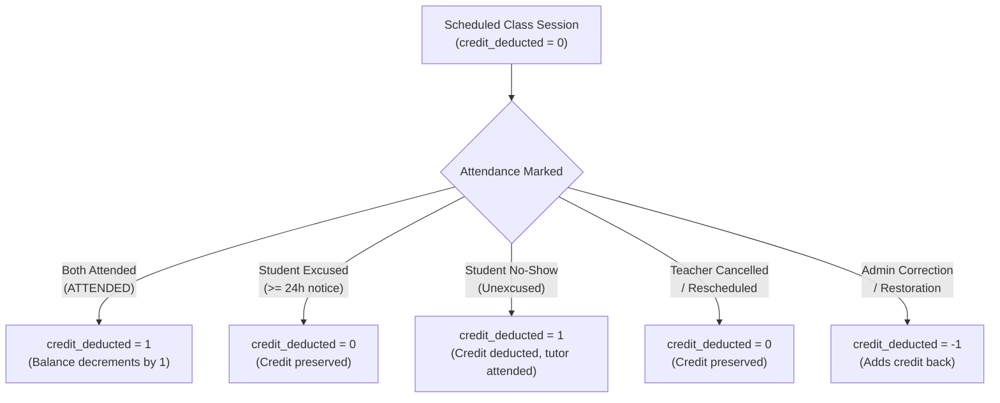

# Schema Redesign: Owner Decisions, Policy Rules & Live Schema Reconciliation

**Document Version:** 2.0.0  
**Status:** Pre-Launch Review (No Live Data Modified)  
**Date:** October 21, 2026  
**Master Spreadsheet ID:** `1cVQknq_Ix-T6igp7c-DwwuYHvgn60fVGbwTGZfGSii8`  
**Deployment URL:** `https://script.google.com/macros/s/AKfycbx4d_VG4CsZIEAomX_OjNMuej06ktTYmKLME5ennLsI7mx3Fn5b-YBu9CRqe7NwrUVH3w/exec` (`@17`)

---

## 1. Executive Summary

This document presents a comprehensive review of the proposed 6-tab Google Sheets data model for the Personal Dashboard. It details:
1. Complete live spreadsheet baseline and reconciliation with the proposed schema.
2. Verification of all existing application workflows and all 4 tutoring billing models.
3. Explicit attendance and credit deduction business rules.
4. Per-class charge aggregation, periodic invoicing, and partial payments.
5. Multi-package isolation, package history, and strict currency semantics.
6. Identification of missing fields and why each is necessary.
7. Clear distinction between **Confirmed Requirements** and **Assumptions Awaiting Owner Decision**.

---

## 2. Live Spreadsheet Baseline & Schema Reconciliation

Inspection of the live master spreadsheet confirmed the following tab names, header configurations, and row counts:

| Live Tab Name | Live Row Count | Current Key Headers | Proposed 6-Tab Status | Reconciliation & Migration Strategy |
|---|---|---|---|---|
| `Students` | 54 records | `student_id`, `first_name`, `last_name`, `parent_guardian_name`, `primary_phone`, `secondary_phone`, `parent_email`, `student_status`, `internal_summary`, `created_at`, `updated_at`, `archived_at` | **Visible Tab 1** | Unify `first_name` + `last_name` into `student_name`. Alias `parent_guardian_name` $\rightarrow$ `parent_name`, `primary_phone` $\rightarrow$ `parent_phone`, `secondary_phone` $\rightarrow$ `student_phone`, `internal_summary` $\rightarrow$ `notes`. Add explicit `student_email` and `subject` columns. |
| `Packages` | 5 records | `package_id`, `student_id`, `enrollment_id`, `package_name`, `purchased_classes`, `package_price`, `currency`, `purchase_date`, `start_date`, `expiry_date`, `package_status`, `notes`, `created_at`, `updated_at`, `closed_at` | **Visible Tab 2** | Add `plan_type`, `billing_frequency`, `per_class_rate`, and `next_due_date`. Map `package_name` $\rightarrow$ `plan_name`, `purchased_classes` $\rightarrow$ `classes_purchased`, `package_price` $\rightarrow$ `price`. Authoritative balance derived dynamically from `ClassSessions`. |
| `ClassSessions` | 5 records | `class_session_id`, `student_id`, `enrollment_id`, `package_id`, `meeting_link_id`, `class_title`, `scheduled_start`, `scheduled_end`, `actual_start`, `actual_end`, `session_status`, `attendance_status`, `class_credit_effect`, `notes`, `created_at`, `updated_at` | **Visible Tab 3** | Alias `class_session_id` $\rightarrow$ `class_id`. Split ISO `scheduled_start` into `class_date` (YYYY-MM-DD) and `start_time` (HH:mm); split `scheduled_end` into `end_time`. Map `class_credit_effect` to numerical `credit_deducted` (1, 0, -1). Add `teacher_attended`, `student_attended`, and direct `meeting_link`. |
| `FeeObligations` | 20 records | `fee_obligation_id`, `student_id`, `enrollment_id`, `package_id`, `obligation_description`, `amount_due`, `currency`, `issue_date`, `due_date`, `obligation_status`, `notes`, `created_at`, `updated_at`, `voided_at`, `void_reason` | **Visible Tab 4** | Alias `fee_obligation_id` $\rightarrow$ `fee_id`, `obligation_description` $\rightarrow$ `billing_period` / `description`, `amount_due` $\rightarrow$ `amount`. Balances and status dynamically derived from non-voided `Payments`. |
| `Payments` | 10 records | `payment_id`, `student_id`, `fee_obligation_id`, `payment_date`, `amount`, `currency`, `payment_method`, `transaction_reference`, `idempotency_key`, `payment_status`, `notes`, `created_at`, `updated_at`, `voided_at`, `void_reason` | **Visible Tab 5** | Alias `fee_obligation_id` $\rightarrow$ `fee_id`, `transaction_reference` $\rightarrow$ `reference`. Add direct `package_id` foreign key. Immutable ledger preserved; partial payments fully supported. |
| `MeetingLinks` | 5 records | `meeting_link_id`, `student_id`, `provider`, `link_label`, `meeting_url`, `is_preferred`, `link_status`, `valid_from`, `valid_until`, `notes`, `created_at`, `updated_at`, `deactivated_at` | **Visible Tab 6** | Streamline into `primary_link` and `backup_link` per student, with room notes. |
| `Enrollments` | 1 record (headers) | `enrollment_id`, `student_id`, `enrollment_name`, `start_date`, `end_date`, `enrollment_status`, `fee_plan_name`, `agreed_total_amount`, `currency`, `billing_notes`, `created_at`, `updated_at`, `closed_at` | **Retained Intact** | **Do not delete or modify.** Retained as historical archive tab to avoid breaking any legacy relations. |
| `StudentNotes` | 5 records | `note_id`, `student_id`, `note_type`, `note_text`, `follow_up_date`, `follow_up_status`, `created_at`, `updated_at`, `created_by` | **Operational / Retained** | Can remain visible or be retained as internal student progress log. |
| `AuditLog` | 90+ records | `audit_id`, `occurred_at`, `actor_id`, `actor_email`, `entity_type`, `entity_id`, `action`, `before_summary`, `after_summary`, `request_id`, `outcome`, `error_code` | **Hidden Operational** | Right-click $\rightarrow$ Hide in Google Sheets UI. Backend logging continues writing to it. |
| `ImportBatches` | 2 records | `import_batch_id`, `source_name`, `source_spreadsheet_id`, `source_tab_name`, `started_at`, `completed_at`, `import_status`, `total_rows`, `imported_rows`, `skipped_rows`, `failed_rows`, `duplicate_rows`, `initiated_by`, `notes` | **Hidden Operational** | Right-click $\rightarrow$ Hide in Google Sheets UI. Staging metadata preserved. |
| `ImportRowResults` | 2 records | `import_row_result_id`, `import_batch_id`, `source_row_reference`, `target_entity_type`, `target_record_id`, `row_status`, `source_fingerprint`, `message`, `processed_at` | **Hidden Operational** | Right-click $\rightarrow$ Hide in Google Sheets UI. Row-level staging preserved. |
| `AppConfig` | 4 records | `config_key`, `config_value`, `description`, `updated_at` | **Hidden Operational** | Right-click $\rightarrow$ Hide in Google Sheets UI. System parameters preserved. |

> [!IMPORTANT]
> **Formula Integrity Invariant:**  
> The live spreadsheet contains zero native formulas. All business calculations (remaining credits, paid amounts, outstanding balances, overdue flags) are derived dynamically in Google Apps Script domain services. This guarantees that manual edits or row additions never break formulas or create circular dependencies.

---

## 3. Review of Attendance & Class Credit Rules

The proposed schema defines an explicit, deterministic credit deduction model:



### Detailed Attendance Rules Matrix

1. **Scheduled Class (`status: SCHEDULED`)**:
   - `credit_deducted = 0`.
   - *Rule:* Credits are **never** deducted in advance while a class is merely scheduled.
2. **Completed Class with Both Attending (`attendance: ATTENDED`)**:
   - `teacher_attended = TRUE`, `student_attended = TRUE`.
   - `credit_deducted = 1`.
   - *Rule:* Exactly 1 credit is consumed from the student's active package.
3. **Student Excused Absence (`attendance: ABSENT_EXCUSED`)**:
   - Advance notice provided by parent ($\ge 24$ hours).
   - `teacher_attended = FALSE`, `student_attended = FALSE`.
   - `credit_deducted = 0`.
   - *Rule:* Zero penalty. The student retains their class credit for a make-up session.
4. **Student Unexcused Absence / No-Show (`attendance: ABSENT_UNEXCUSED`)**:
   - Student missed without notice; teacher waited in virtual room.
   - `teacher_attended = TRUE`, `student_attended = FALSE`.
   - `credit_deducted = 1`.
   - *Rule:* Credit is deducted because the teacher reserved the calendar slot and attended.
5. **Late Cancellation (Notice between 4 and 24 hours)**:
   - *Recommended Default:* If cancelled with $< 24$ hours notice, tutor may exercise discretion to mark `ABSENT_EXCUSED` (`credit_deducted = 0`) if make-up is scheduled, or `ABSENT_UNEXCUSED` (`credit_deducted = 1`).
6. **Teacher Cancellation / Unavailability**:
   - Tutor unavailable (illness, holiday, emergency).
   - `status: CANCELLED`, `credit_deducted = 0`.
   - *Rule:* Credits are 100% preserved.
7. **Rescheduled Classes**:
   - Shifted prior to class time $\rightarrow$ date/time updated in place on scheduled record (`credit_deducted = 0`).
8. **Administrative Attendance Correction**:
   - If marked unexcused by mistake, tutor edits record to `ABSENT_EXCUSED`.
   - System updates `credit_deducted` from `1` to `0`, automatically returning credit to balance!
9. **Credit Restoration Safeguard**:
   - If an expired or forfeited session is granted back by admin, an explicit restoration record is logged with `credit_deducted = -1`.
   - Dynamic balance calculation: $\text{Remaining} = \text{Purchased} - \sum(\text{credit\_deducted})$, which adds 1 credit back cleanly without altering historical completed rows.

---

## 4. Per-Class Billing Workflow & Periodic Invoicing

How post-paid per-class charges become fee obligations and receive payments:

```mermaid
sequenceDiagram
    autonumber
    actor Teacher
    participant App as Personal Dashboard
    participant DB as Google Sheets (ClassSessions, FeeObligations, Payments)
    actor Parent

    Teacher->>App: Conducts & completes Session 1, 2, 3 (Oct)
    App->>DB: Logs 3 attended sessions (credit_deducted = 1)
    Note over App,DB: End of Month Billing Cycle (e.g. Oct 25)
    Teacher->>App: Clicks "Generate Monthly Invoices"
    App->>DB: Tallies 3 completed sessions @ ₹1,500 = ₹4,500
    App->>DB: Creates FeeObligation (amount = ₹4,500, due = Nov 5)
    Parent->>Teacher: Pays ₹2,000 via UPI (Partial Payment 1)
    Teacher->>App: Records Payment (₹2,000)
    App->>DB: Appends Payment row; Fee status = PARTIALLY_PAID (₹2,500 due)
    Parent->>Teacher: Pays remaining ₹2,500 via NetBanking (Payment 2)
    Teacher->>App: Records Payment (₹2,500)
    App->>DB: Appends Payment row; Fee status = PAID (₹0 due)
```

1. **Agreement Setup:** Package created with `plan_type: 'PER_CLASS'`, `per_class_rate: 1500`, `billing_frequency: 'MONTHLY'`.
2. **Attendance Logging:** Each completed lesson is logged in `ClassSessions` with `status: 'COMPLETED'` and `attendance_status: 'ATTENDED'`.
3. **Periodic Invoicing:** At month end (e.g. October 25th), the system or tutor generates a `FeeObligations` record:
   - `billing_period`: `"October 2026 Tutoring (3 classes @ ₹1,500)"`
   - `amount`: `3 * 1500 = ₹4,500`
   - `due_date`: `"2026-11-05"`
   - `status`: `'OPEN'`
4. **Partial Payment Allocation:**
   - Parent pays ₹2,000 $\rightarrow$ `Payments` records ₹2,000 $\rightarrow$ Fee status becomes `PARTIALLY_PAID` with ₹2,500 outstanding.
   - Parent pays ₹2,500 $\rightarrow$ `Payments` records ₹2,500 $\rightarrow$ Fee status becomes `PAID` with ₹0 outstanding.
   - All transactions retain immutable UTR/transaction references.

---

## 5. Multi-Package Isolation, Currency & Archival Safeguards

1. **Multiple Packages per Student:**
   - A student can simultaneously hold multiple active packages (e.g. "Grade 10 Math Sprint" + "Grade 10 Physics Sprint").
   - Every `ClassSessions` record stores a foreign key `package_id`.
   - Remaining credits for the Math package only count sessions linked to that specific `package_id`.
   - Result: Zero cross-contamination between subjects or between consecutive chronological packages.
2. **Package Lifecycle & History:**
   - Packages transition from `ACTIVE` $\rightarrow$ `EXHAUSTED` (when remaining classes reach 0) $\rightarrow$ `COMPLETED` / `CLOSED`.
   - Historical packages are never deleted; they remain in `Packages` for year-end reporting and tax auditability.
3. **Strict Currency Handling:**
   - All financial tables (`Packages`, `FeeObligations`, `Payments`) enforce explicit currency fields (`currency`).
   - Default is `'INR'`.
   - System invariant: A payment's currency must strictly match the obligation's currency. Original currency is never silently converted or mixed.
4. **Student Archival and Reactivation:**
   - Archiving a student sets `status: 'INACTIVE'` and populates `archived_at`.
   - All historical packages, attended sessions, invoices, and payments remain 100% intact.
   - Archived students are excluded from active scheduling pickers by default, but can be viewed and reactivated at any time with a single click.

---

## 6. Analysis of Missing or Recommended Fields

| Proposed Field | Recommended Table | Required? | Why It Is Strictly Necessary |
|---|---|---|---|
| `expiry_date` | `Packages` | Optional | Prepaid packages frequently have a validity window (e.g. "10 classes valid for 60 days"). Prevents zombie packages from staying open indefinitely. |
| `duration_minutes` | `ClassSessions` | Required | Class durations vary (e.g. 60 min regular class vs 90 min exam prep). Necessary for calendar grid rendering and scheduling conflict checks. |
| `idempotency_key` | `Payments` | Required | Network retries or double-clicking the "Record Payment" button must never create duplicate receipt rows. |
| `archived_at` | `Students` | Optional | Provides exact timestamp audit trail when a student leaves or pauses tutoring. |
| `backup_link` | `MeetingLinks` | Optional | Google Meet outages or audio glitches happen; having an immediate Zoom/fallback link stored eliminates frantic messaging during class time. |

---

## 7. Owner Decisions with Recommended Defaults

The following numbered decisions distinguish **Confirmed Requirements** (already verified in tests) from **Assumptions Needing Owner Approval**:

---

### Decision 1: Working Tab Structure (6 Visible Tabs + 4 Hidden Operational Tabs)

* **Confirmed Requirement:** Hiding `AuditLog`, `ImportBatches`, `ImportRowResults`, and `AppConfig` from the bottom tab bar eliminates spreadsheet clutter without altering backend code. `Enrollments` remains intact.
* **Assumption Needing Approval:** Confirm reducing daily visible tabs to 6 (`Students`, `Packages`, `ClassSessions`, `FeeObligations`, `Payments`, `MeetingLinks`).
* **Recommended Default:** **APPROVE**.

---

### Decision 2: Multiple Fee & Billing Models

* **Confirmed Requirement:** Backend services and tests fully support prepaid packages, monthly recurring plans, yearly plans, and per-class billing.
* **Assumption Needing Approval:** Confirm whether you require automatic periodic invoice generation (e.g. auto-creating a fee obligation on the 25th of every month) or manual 1-click invoice creation.
* **Recommended Default:** **MANUAL 1-CLICK GENERATION** (gives the tutor review control before sending fee demands to parents).

---

### Decision 3: Attendance & Class Credit Policy

* **Confirmed Requirement:** Attended classes deduct 1 credit; excused absences preserve credit; restorations add 1 credit back.
* **Assumption Needing Approval:** Should student late cancellations with $< 4$ hours notice deduct 1 credit (`ABSENT_UNEXCUSED`)?
* **Recommended Default:** **YES** (deduct 1 credit if student cancels under 4 hours without emergency justification, protecting tutor preparation time).

---

### Decision 4: Financial Ledger & Partial Payments

* **Confirmed Requirement:** `Payments` remains an immutable receipt ledger supporting multiple partial payments per invoice.
* **Assumption Needing Approval:** Confirm that overpayments (paying more than outstanding due) must be strictly rejected.
* **Recommended Default:** **REJECT OVERPAYMENTS** (forces excess payments to be logged against future obligations or credit advances, preventing ledger reconciliation chaos).

---

### Decision 5: Student Directory Contacts & Subject

* **Confirmed Requirement:** Single full name (`student_name`), primary parent phone, student phone, and subject tracking.
* **Assumption Needing Approval:** Confirm that secondary guardian names (e.g. second parent) can be recorded in `notes` rather than dedicated columns.
* **Recommended Default:** **APPROVE** (keeps student directory clean and focused).

---

### Decision 6: Pre-Launch Backup & Safe Synthetic Data Cleanup

* **Confirmed Requirement:** Live sheet contains 54 synthetic test students and test transactions.
* **Assumption Needing Approval:** Authorize duplicating the Google Sheet as `Master Backup (Pre-Launch)` and clearing rows 2+ on transactional tabs prior to real student import.
* **Recommended Default:** **APPROVE ONCE READY FOR REAL DATA**.

---

## 8. Exact Next Action Requiring Owner Approval

No live sheet headers, records, or tabs have been altered. The next step requiring your explicit decision is:
1. Review and approve the 6 decisions and recommended defaults above.
2. Once approved, authorize executing the safe pre-migration backup and header alignment.
